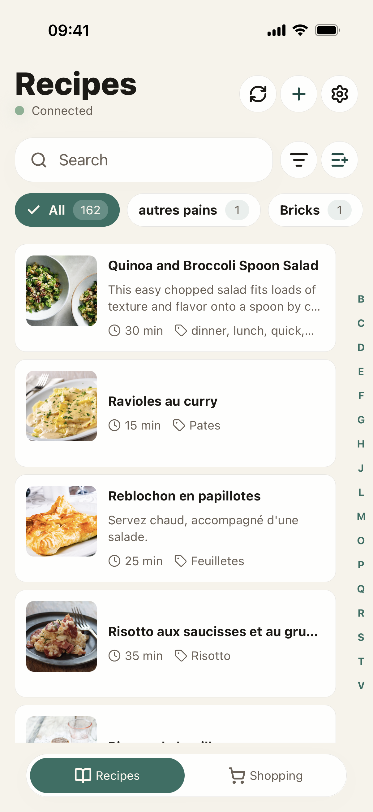
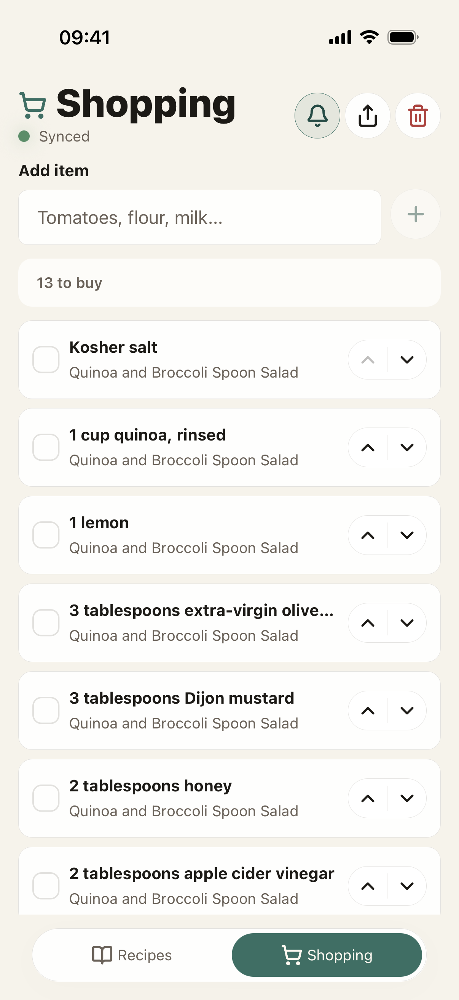

# AvoCook

[English](README.md) · [Français](docs/fr/README.md) · [Deutsch](docs/de/README.md) · [Español](docs/es/README.md) · [Italiano](docs/it/README.md) · [Dansk](docs/da/README.md)

AvoCook is a free, open-source app for iOS and Android. I’m building it alongside my studies to keep my recipes, plan meals and make everyday cooking a little easier.

[App Store](https://apps.apple.com/app/avocook/id6769012665) · [Google Play](https://play.google.com/store/apps/details?id=app.avocook.mobile) · [APK](https://github.com/Logarex/AvoCook/releases/latest)

[](https://github.com/Logarex/AvoCook/releases)

<p align="center">
  
  
  
</p>

## Features

- Recipes with photos, categories, adjustable servings, web import and optional Markdown.
- Fridge, pantry and freezer inventory, with barcode entry, dates and expiry reminders.
- Daily and weekly meal plans, simple meals, leftovers, saved menus and meal history.
- Step-by-step cooking, persistent timers, local voice commands and private notes.
- Ingredient-based ideas, regional seasonal calendars, conversions and baking substitutions.
- Local or shared shopping lists, push notifications, Nextcloud Pantry and Apple Reminders on iOS.
- Illustrated PDF cookbooks, recipe sharing and complete kitchen backups.
- Community recipes to discover, translate and share; an optional assistant with your own API key.

Local recipes work offline without an account. Nextcloud Cookbook sync is optional; meal plans, inventory and private notes stay on the device.

## Guides

- [Kitchen guide](docs/GUIDE.md)
- [Your data and connections](PRIVACY.md)
- [Technical references](docs/LOCAL_KITCHEN.md) · [Nextcloud Pantry](docs/NEXTCLOUD_PANTRY.md) · [Seasonal catalog](docs/SEASONAL_CATALOG.md)

<details>
<summary>Development and project structure</summary>

## Development setup

The project uses Expo SDK 57, React Native 0.86 and TypeScript. Node.js >=22.13 and <27 is required. Local iOS builds use Xcode 27 and Device Hub; the minimum supported iOS version is 16.4.

Local Android builds require JDK 17 and Android SDK 36. Set `JAVA_HOME` to your JDK 17 installation if your system still defaults to an older Java version.

```bash
npm ci
npm run ios      # iOS simulator
npm run android  # Android emulator
```

After native dependency changes, run `npx expo prebuild --clean` and rebuild. On-device voice commands and stock reminders require the local native modules; Expo Go is insufficient.

A development build with native modules is compiled on the first run. After that, the app opens directly.

The `ios/` and `android/` projects are generated from `app.json`, `tools/plugins/` and `src/modules/`. After a native dependency or SDK upgrade, run `npx expo prebuild --clean` before building again. iOS builds React Native from source because the prebuilt 0.86.3 framework is missing a symbol required by Gesture Handler in Debug builds. The first build takes longer.

### Liquid Glass

On iOS 26+, buttons use native SwiftUI controls through [`@expo/ui`](https://docs.expo.dev/versions/v57.0.0/sdk/ui/swift-ui/). SwiftUI also provides sheets, menus and segmented controls. The native UIKit tab bar stays mounted when changing pages so its selection can move between tabs. Search fields use [`expo-glass-effect`](https://docs.expo.dev/versions/v57.0.0/sdk/glass-effect/).

Older iOS versions use blur. Android and Reduce Transparency use opaque backgrounds. Keep recipe content and forms on `GlassPanel`. Rebuild the app after adding a native module.

Useful commands:

```bash
npm run typecheck          # TypeScript checks
npm test                   # Unit tests (Vitest)
npm run lint               # ESLint
npm run import:check -- <recipe-url>  # Test a recipe import from a URL
```

---

## Project structure

```
src/
├── App.tsx                        # Entry point, navigation setup
├── screens/                       # Application screens (list, detail, editor, settings…)
├── components/                    # Reusable UI components
├── features/
│   ├── kitchen/                   # My kitchen — everyday meals, locally
│   ├── community/                 # Firebase
│   ├── recipes/                   # Local storage (SQLite), recipe logic, backup/restore
│   ├── nextcloud/                 # HTTP client for Nextcloud Cookbook
│   ├── import/                    # URL and photo recipe import
│   ├── shopping/                  # Shopping list and iOS Reminders sync
│   ├── timers/                    # Cooking timers
│   ├── preferences/               # App settings
│   └── auth/                      # Nextcloud authentication
├── i18n/                          # Internationalisation (i18next, 6 languages)
├── modules/
│   ├── avocook-native-controls/     # Native iOS tab bar
│   └── avocook-timer-notifications/  # Native timer notifications
└── theme/                         # Colors, typography, shared styles
tools/                             # Build plugins and import checker
docs/                              # Documentation in other languages (fr, de, es, it, da)
```

---

</details>

## Nextcloud Cookbook

To test the sync:

1. Install the [Cookbook app](https://apps.nextcloud.com/apps/cookbook) on a Nextcloud instance.
2. Create an **app password** in the security settings (Settings → Security → Devices & sessions).
3. In AvoCook, go to Settings and enter your server URL, username, and that password.

HTTPS is used by default when no protocol is entered. For a Nextcloud server on your trusted local network, enter an explicit HTTP address, such as `http://192.168.1.50:8080/nextcloud` or `http://nextcloud.local`. HTTP sends your app password and recipes without encryption; use it only on a trusted network. Credentials remain encrypted in the device keychain.

---

## Android

APKs are published in the [GitHub releases](https://github.com/Logarex/AvoCook/releases). Download `avocook.apk` and install it directly.

---

## Contributing

Pull requests are welcome. See [CONTRIBUTING.md](.github/CONTRIBUTING.md) for the guidelines and the PR template.

---

## Support the project ☕

If you find AvoCook useful, you can help cover the costs:

**[→ Donate via Revolut](https://revolut.me/logarex)** · **[→ Donate via PayPal](https://paypal.me/logarex31)**

---

## Licence

This project is licenced under the [GPLv3](LICENSE) licence.
