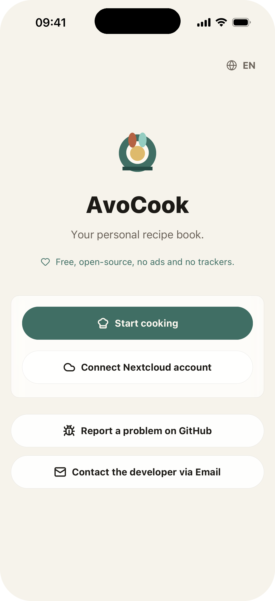
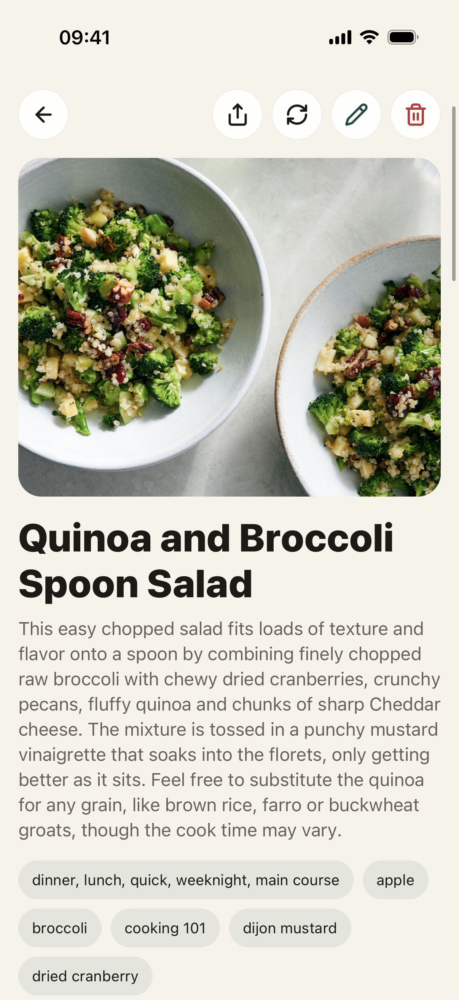

# AvoCook

AvoCook is a mobile recipe notebook — it works entirely offline, on your device, with no account needed. If you already run a Nextcloud server, you can optionally connect it to keep everything in sync.

I built it for personal use while learning to ship a complete React Native project from start to finish.

[App Store](https://apps.apple.com/app/avocook/id6769012665) ·
[Google Play](https://play.google.com/store/apps/details?id=app.avocook.mobile) · [Android APK](https://github.com/Logarex/AvoCook/releases/latest) ·
[](https://github.com/Logarex/AvoCook/releases)

<div align="center">
  
  
</div>

---

## Features

### Community Platform

- Discover, rate, and import recipes from the AvoCook community;
- Community recipes automatically appear in your app language, in both the list and the recipe details;
- Choose a separate translation language for the community, including Chinese, Portuguese, Dutch, Japanese, Korean, Arabic and Russian;
- Previously loaded community recipes and successful translations are cached on the device for faster reopening and offline reading;
- View the original recipe at any time, or import the translated version into your recipe book;
- Share your best meals by setting up a community profile;
- Safe and moderated platform with built-in spam detection.

### Recipes

- Create and edit recipes locally, no account required;
- Organise recipes by category;
- Adjust ingredient quantities to the number of servings;
- Add one or more photos per recipe;
- Export a recipe as PDF or print it directly;
- Share a recipe with another app (share sheet).

### My kitchen (local, free)

- Plan a week with drag-and-drop recipes, adjustable servings and lunch/dinner slots;
- Plan simple meals, leftovers and eating out without creating a recipe; only meals that need groceries generate ingredients;
- Preview consolidated groceries and update a generated week atomically in local shopping mode, retaining manual items and unchanged checked items;
- Enter the ingredients available tonight, or use dated fridge, cupboard and freezer stock, to find recipes with fewer missing ingredients;
- Cook one large-print step at a time with manually attached step timers, and optional strictly on-device voice commands when supported;
- Keep private ratings, notes, changes, dietary labels, estimated costs and cooking history;
- Explore a sourced offline mainland-France seasonal catalog, context-specific baking substitutions, batch preparation and reusable celebration menus;
- Create a text PDF cookbook and export/restore a complete backup including private My kitchen data;
- Join an optional friendly monthly community challenge using the existing recipe sharing and rating system.

Open the **My kitchen** bottom tab. Dietary labels are entered by the user and do not certify the absence of allergens. Ingredient matching is conservative and does not check available quantities or food safety. See [behavior, limits and validation](docs/LOCAL_KITCHEN.md).

Voice commands and stock reminders require a new native build. Run `npx expo prebuild --clean`, install iOS pods, and rebuild both apps after switching to this branch. The buttons remain optional when capabilities or permissions are unavailable.

### Optional Markdown

All recipe text fields accept Markdown, in every language: name, description, category, keywords, source name, ingredients, instructions, tools and nutrition values. Plain text remains the default; no Markdown knowledge is needed.

Use `**bold**`, `*italic*`, headings, lists, quotes, code, tables or `[a link](https://example.com)`. Formatting appears when reading recipes and when exporting a PDF or printing. Images written in Markdown appear as links. Numbers (servings and durations) and URL fields retain their usual format.

Each ingredient and instruction keeps its own Markdown, including paragraphs and nested lists. Pasting a simple list of plain text lines still creates separate items; pasting block Markdown keeps the block together.

### Import

- Import a recipe from a URL — works on any site that exposes `schema.org/Recipe` data (Marmiton, 750g, BBC Good Food, and many others);
- Receive a URL shared from a browser or another app to import a recipe in one tap;
- Scan a recipe from a photo, or generate a recipe from a picture of a dish using AI (requires an OpenAI-compatible API key).

### Shopping list

- Share grocery lists using a 6-character code, with a participant count and local change alerts while AvoCook is running;
- Copy ingredients to the clipboard with a tap;
- Choose one shopping mode at a time: local, AvoCook live sharing, or an optional [Nextcloud Pantry household list](docs/NEXTCLOUD_PANTRY.md). Your items are carried over when switching modes;
- Export a shopping list to iOS Reminders to take advantage of Apple's sharing and Siri integration.

### Timers

- Start one or several cooking timers directly from a recipe;
- Timers trigger a local notification even when the app is in the background.

### Data & sync

- Back up all recipes to a JSON file and restore them;
- **Optional**: connect a Nextcloud Cookbook server to sync recipes across devices. All data goes directly between the app and your server — nothing passes through a third-party service.

> Local recipes stay on your device unless you sync, share or export them. Community features use Firebase, including an anonymous session at startup. See [Privacy and data](PRIVACY.md).

---

## Available languages

French · English · German · Spanish · Italian · Danish

---

## Development setup

The project uses Expo SDK 57, React Native 0.86 and TypeScript. Node.js 22.13 or newer is required. Local iOS builds use Xcode 27 and Device Hub; the minimum supported iOS version is 16.4.

Local Android builds require JDK 17 and Android SDK 36. Set `JAVA_HOME` to your JDK 17 installation if your system still defaults to an older Java version.

```bash
npm install
npm run ios      # iOS simulator
npm run android  # Android emulator
```

A development build with native modules is compiled on the first run. After that, the app opens directly.

The `ios/` and `android/` projects are generated from `app.json`, `tools/plugins/` and `src/modules/`. After a native dependency or SDK upgrade, run `npx expo prebuild --clean` before building again. iOS builds React Native from source because the prebuilt 0.86.3 framework is missing a symbol required by Gesture Handler in Debug builds. The first build takes longer.

### Liquid Glass

On iOS 26+, buttons use native SwiftUI controls through [`@expo/ui`](https://docs.expo.dev/versions/v57.0.0/sdk/ui/swift-ui/). SwiftUI also provides sheets, menus and segmented controls. The native UIKit tab bar stays mounted when changing pages so its selection can move between tabs. Search fields use [`expo-glass-effect`](https://docs.expo.dev/versions/v57.0.0/sdk/glass-effect/).

Older iOS versions use blur. Android and Reduce Transparency use opaque backgrounds. Keep recipe content and forms on `GlassPanel`. Rebuild the app after adding a native module.

Useful commands:

```bash
npm run typecheck          # TypeScript checks
npm test                   # Unit tests (Vitest)
npm run lint               # ESLint
npm run import:check -- <recipe-url>  # Test a recipe import from a URL
```

---

## Project structure

```
src/
├── App.tsx                        # Entry point, navigation setup
├── screens/                       # Application screens (list, detail, editor, settings…)
├── components/                    # Reusable UI components
├── features/
│   ├── recipes/                   # Local storage (SQLite), recipe logic, backup/restore
│   ├── nextcloud/                 # HTTP client for Nextcloud Cookbook
│   ├── import/                    # URL and photo recipe import
│   ├── shopping/                  # Shopping list and iOS Reminders sync
│   ├── timers/                    # Cooking timers
│   ├── preferences/               # App settings
│   └── auth/                      # Nextcloud authentication
├── i18n/                          # Internationalisation (i18next, 6 languages)
├── modules/
│   ├── avocook-native-controls/     # Native iOS tab bar
│   └── avocook-timer-notifications/  # Native timer notifications
└── theme/                         # Colors, typography, shared styles
tools/                             # Build plugins and import checker
docs/                              # Documentation in other languages (fr, de, es, it, da)
```

---

## Nextcloud Cookbook

To test the sync:

1. Install the [Cookbook app](https://apps.nextcloud.com/apps/cookbook) on a Nextcloud instance.
2. Create an **app password** in the security settings (Settings → Security → Devices & sessions).
3. In AvoCook, go to Settings and enter your server URL, username, and that password.

HTTPS is used by default when no protocol is entered. For a Nextcloud server on your trusted local network, enter an explicit HTTP address, such as `http://192.168.1.50:8080/nextcloud` or `http://nextcloud.local`. HTTP sends your app password and recipes without encryption; use it only on a trusted network. Credentials remain encrypted in the device keychain.

---

## Android

APKs are published in the [GitHub releases](https://github.com/Logarex/AvoCook/releases). Download `avocook.apk` and install it directly.

---

## Contributing

Pull requests are welcome. See [CONTRIBUTING.md](.github/CONTRIBUTING.md) for the guidelines and the PR template.

---

## Support the project ☕

If you find AvoCook useful, you can help cover the costs:

**[→ Donate via Revolut](https://revolut.me/logarex)** · **[→ Donate via PayPal](https://paypal.me/logarex31)**

---

## Licence

This project is licenced under the [GPLv3](LICENSE) licence.
