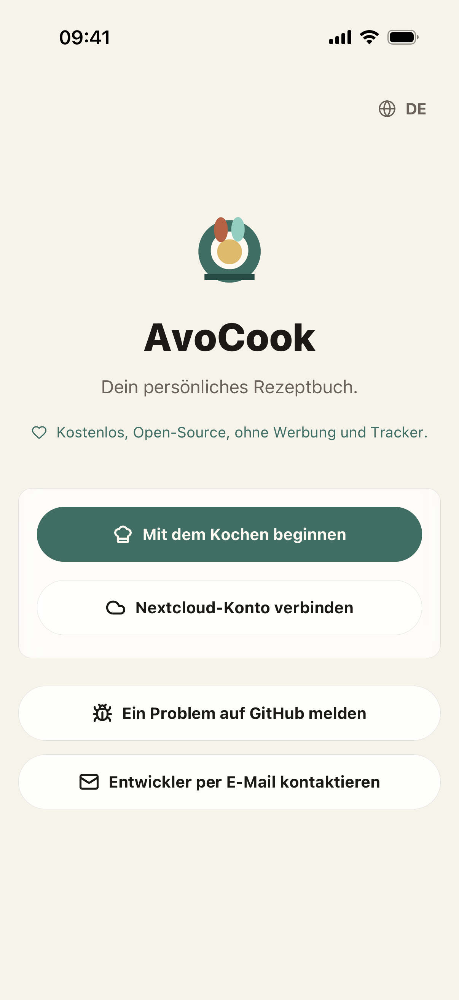
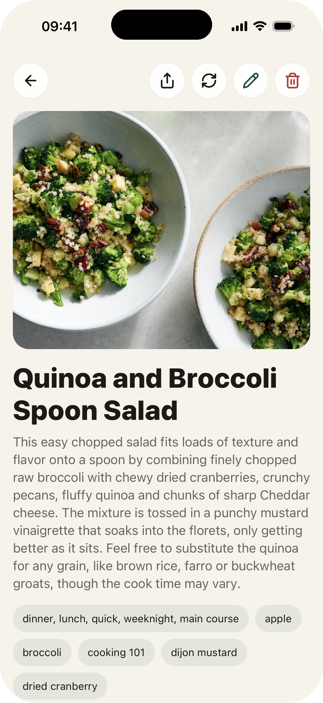

# AvoCook

[English](../../README.md) · [Français](../fr/README.md) · [Deutsch](README.md) · [Español](../es/README.md) · [Italiano](../it/README.md) · [Dansk](../da/README.md)

AvoCook ist ein kostenloser Open-Source-Küchenbegleiter für iOS und Android, mit oder ohne Rezept. Rezepte sammeln, Alltagsmahlzeiten planen, Vorräte nutzen und Einkäufe vorbereiten: Die lokalen Werkzeuge funktionieren offline ohne eigenes Konto. Community, geteilte Listen, Importe, optionale KI und Nextcloud-Verbindungen nutzen Onlinedienste.

Ich habe es für den persönlichen Gebrauch entwickelt und dabei gelernt, ein vollständiges React Native-Projekt von Anfang bis Ende umzusetzen.

[App Store](https://apps.apple.com/app/avocook/id6769012665) · [Google Play](https://play.google.com/store/apps/details?id=app.avocook.mobile) · [Android APK](https://github.com/Logarex/AvoCook/releases/latest) · [](https://github.com/Logarex/AvoCook/releases)

<div align="center">
  
  
</div>

> Dieses README beschreibt den aktuellen Quellcode-Branch. Store- und GitHub-Versionen enthalten möglicherweise noch nicht die neuesten Änderungen.

---

## Neu in Version 5.0.0

Fünf Tabs: Rezepte, Meine Küche, Wochenplan, Community und Einkauf. Meine Küche enthält Vorräte und Essensideen; der Wochenplan startet mit Heute und bietet die Wochenansicht.

- **Gut sortierte Vorräte** — Kühlschrank, Schrank und Gefrierfach mit Suche, Mengen und Daten. Strichcode scannen oder Lebensmittel eingeben. Nutri-Score und Green-Score von Open Food Facts, soweit verfügbar; optionale lokale Erinnerungen.
- **Ein eigener Essensplan** — Heute und die Woche planen: Rezepte, einfache Mahlzeiten, Reste oder auswärts essen. Portionen anpassen, Mahlzeiten verschieben und Einkäufe vorbereiten. Wiederverwendbare Menüs und die Vorbereitung mehrerer Rezepte bleiben verfügbar.
- **Kochen und Gewohnheiten festhalten** — Schritte mit Timern und unterstützten lokalen Sprachbefehlen verfolgen. Notizen, Zubereitungen und gewohnte Mahlzeiten im privaten Tagebuch und Verlauf speichern. Timer werden ohne doppelte Meldungen wiederhergestellt.
- **Werkzeuge für den Alltag** — Belegte Saisonkalender für 11 Länder mit regionalen Grenzen, Umrechnungen und anwendungsbezogene Alternativen. PDF-Kochbuch erstellen und Rezepte zusammen mit privaten Küchendaten sichern.
- **Eine Idee aus Ihren Zutaten** — Zutaten eingeben oder ein Foto analysieren, Liste korrigieren und einen bearbeitbaren Entwurf erzeugen. Optionale KI mit Ihrem Anbieter, API-Schlüssel und einem passenden Modell; Kosten sind möglich.
- **Eine leichtere Oberfläche** — Kompakte Rezept- und Einkaufsaktionen, nach Lagerort sortierte Lebensmittel und Details bei Bedarf. Kleinere Kategorieelemente und an Bildschirm- und Textgröße angepasste Ansichten.

Das Datum auf der Packung selbst eingeben. Produktdaten und Bewertungen können fehlen und stellen keine vollständige Produktanalyse dar. Die Produktsuche benötigt Internet; Vorräte und Planung bleiben lokal. Benachrichtigungen hängen von Geräteberechtigungen ab.

## Funktionen

### Community-Plattform

- Entdecke, bewerte und importiere Rezepte aus der AvoCook-Community;
- Community-Rezepte werden in der Liste und in der Detailansicht automatisch in deiner App-Sprache angezeigt;
- Sieh dir jederzeit das Original an oder importiere die übersetzte Version in dein Rezeptheft;
- Teile deine besten Gerichte, indem du ein Community-Profil erstellst;
- Community-Meldungen und Spamprüfungen sind enthalten; veröffentlichte Inhalte stammen von Nutzern.
- Eine eigene Übersetzungssprache für die Community wählen, darunter Chinesisch, Portugiesisch, Niederländisch, Japanisch, Koreanisch, Arabisch und Russisch. Geladene Rezepte und erfolgreiche Übersetzungen werden zum Offline-Lesen gespeichert.

### Rezepte

- Rezepte lokal erstellen und bearbeiten, ohne Konto;
- Rezepte nach Kategorie organisieren;
- Zutatenmengen nach Portionenanzahl anpassen;
- Ein oder mehrere Fotos pro Rezept hinzufügen;
- Ein Rezept als PDF exportieren oder direkt drucken;
- Ein Rezept über die Teilen-Funktion weitergeben.

### Meine Küche — Alltagsmahlzeiten lokal planen

Fünf Tabs: Rezepte, Meine Küche, Wochenplan, Community und Einkauf. Meine Küche enthält Vorräte und Essensideen; der Wochenplan startet mit Heute und bietet die Wochenansicht.

- **Die Woche planen** — Mittag- und Abendessen eintragen, Rezepte zwischen Tagen verschieben und Portionen anpassen. Zusammengefasste Zutaten vor dem Einkauf prüfen.
- **Mahlzeiten ohne Rezept** — Schnelles Essen notieren, übliche Mahlzeiten wiederverwenden oder Reste und Restaurantbesuche planen. Nur Mahlzeiten mit Zutaten ergänzen die Einkaufsliste.
- **Vorhandenes nutzen** — Kühlschrank-, Vorrats- und Tiefkühlprodukte mit Datum speichern. Rezepte mit wenigen fehlenden Zutaten finden und Einkäufe prüfen. Optionale lokale Datumserinnerungen.
- **Obst und Gemüse der Saison** — Region und Monat wählen, suchen oder filtern und Produkte für Einkäufe oder Rezeptideen auswählen. Quellenbasierte Offline-Kalender mit klaren regionalen Grenzen.
- **Schritt für Schritt kochen** — Ein Schritt in großer Schrift, Fortschritt, Zutaten und Timer. Optionale lokale Sprachbefehle auf unterstützten Geräten; Meldungen hängen von Berechtigungen und Systemeinstellungen ab.
- **Ein Rezept aus dem Kühlschrank (KI)** — Zutaten eingeben oder ein Foto analysieren, erkannte Lebensmittel korrigieren und einen bearbeitbaren Entwurf erzeugen. Optional: eigener API-Schlüssel und geeignetes Modell; Anbietergebühren sind möglich.
- **Ein privates Kochtagebuch** — Bewertungen, Notizen, Änderungen, Zubereitungsdaten, Schwierigkeit und manuell eingetragene Kosten. Eigene Ernährungskennzeichnungen und Filter helfen beim Ordnen; sie garantieren keine Allergenfreiheit.
- **Vorkochen und Menüs** — 3–5 Rezepte wählen, Einkäufe zusammenfassen und Vorbereitung nach Dauer durchgehen. Festmenüs speichern und einplanen; kein automatisches paralleles Kochen.
- **Dein eigenes Kochbuch** — Bis zu 50 Rezepte als lokales Text-PDF mit Inhaltsverzeichnis, Zutaten und Schritten auswählen. Private Notizen und Fotos sind nicht enthalten.
- **Praktische Küchenwerkzeuge** — Zufallsrezept wählen, kompatible Einheiten und Temperaturen umrechnen oder kontextabhängigen Backersatz mit Mengen und Hinweisen nachschlagen. Keine geschätzte Umrechnung von Gramm in Milliliter.
- **Eigene Sicherungen** — Rezepte als JSON exportieren oder die vollständige Meine-Küche-Sicherung für Rezepte, verfügbare lokale Fotos und private Planungsdaten nutzen. Vor der Wiederherstellung prüfen.

Verfügbare Kalender: französisches Mutterland, Wallonien (Belgien), Schweiz, Deutschland, Spanien, Italien, Vereinigtes Königreich, Dänemark, Ontario (Kanada), Bundesstaat New York (USA) und Sydney (Australien). 11 Länder mit regionalen Grenzen, keine weltweite Abdeckung. Quellen unterscheiden Ernte, Lagerung und Marktangebot; dies sind Orientierungshilfen, keine Echtzeitprognosen.

Zutatenabgleiche prüfen weder vorhandene Mengen noch Frische oder Allergene. Ernährungskennzeichnungen werden selbst eingetragen. Ersatzvorschläge gelten nur für unterstützte Zubereitungen. Sprachbefehle und Benachrichtigungen hängen von Gerät und Berechtigungen ab.

[Verhalten und Grenzen](../LOCAL_KITCHEN.md) · [Quellen der Saisonkalender](../SEASONAL_CATALOG.md)

Essensideen nach bekannter Dauer (≤30 Minuten), eigener Bewertung (≥4/5), einfacher Schwierigkeit und eigenen Ernährungskennzeichnungen filtern. Der Verlauf enthält als gegessen bestätigte Mahlzeiten und im Tagebuch oder Kochmodus erfasste Zubereitungen.

### Optionales Markdown

Alle Textfelder der Rezepte unterstützen Markdown in jeder Sprache: Name, Beschreibung, Kategorie, Schlagwörter, Quellenname, Zutaten, Anweisungen, Küchenutensilien und Nährwerte. Einfacher Text bleibt der Standard; Markdown-Kenntnisse sind nicht erforderlich.

Verwenden Sie `**fett**`, `*kursiv*`, Überschriften, Listen, Zitate, Code, Tabellen oder `[einen Link](https://example.com)`. Die Formatierung erscheint beim Lesen, im PDF und beim Drucken. Markdown-Bilder erscheinen als Links. Zahlen (Portionen und Zeitangaben) und URL-Felder behalten ihr übliches Format.

Jede Zutat und Anweisung behält ihr Markdown, einschließlich Absätzen und verschachtelten Listen. Eingefügte einfache Textzeilen erzeugen weiterhin einzelne Einträge; eingefügte Markdown-Blöcke bleiben zusammen.

### Import

- Von unterstützten Seiten mit zugänglichen `schema.org/Recipe`-Daten importieren; manche Seiten blockieren das Auslesen oder liefern unvollständige Daten.
- Eine aus einem Browser oder einer anderen App geteilte URL empfangen, um Rezepte mit einem Tippen zu importieren;
- Optionale KI: Rezepte scannen, aus Text oder einem Gerichtsfoto generieren oder einen Kühlschrankentwurf erstellen. In den Assistent-Einstellungen OpenAI, Gemini, Groq, Grok, Mistral, Claude oder einen eigenen Endpunkt wählen. Eigener API-Schlüssel und geeignetes Modell erforderlich; Fotos benötigen Bilderkennung und Anbietergebühren sind möglich.

### Einkaufsliste

- Lokale Liste, AvoCook-Freigabe oder Nextcloud Pantry wählen; Artikel werden beim Wechsel übernommen. Die optionale iOS-Erinnerungen-Synchronisierung funktioniert in allen drei Modi. [Nextcloud Pantry](../NEXTCLOUD_PANTRY.md).
- Teile Einkaufslisten mit einem Code aus 6 Zeichen, einer Teilnehmeranzahl und lokalen Hinweisen, während AvoCook läuft;
- Zutaten mit einem Tippen in die Zwischenablage kopieren;
- Eine Einkaufsliste in iOS-Erinnerungen exportieren, um Apples Teilen-Funktion und Siri-Integration zu nutzen.

### Timer

- Einen oder mehrere Koch-Timer direkt aus einem Rezept starten;
- Lokale Timer-Meldungen funktionieren im Hintergrund, sofern Berechtigungen und Systemeinstellungen dies erlauben; Zustellung auf dem eigenen Gerät prüfen.

### Daten & Synchronisierung

- Alle Rezepte in einer JSON-Datei sichern und wiederherstellen;
- **Optional**: einen Nextcloud Cookbook-Server verbinden, um Rezepte geräteübergreifend zu synchronisieren. Die Daten fließen direkt zwischen der App und deinem Server — kein Drittanbieter ist beteiligt.

> Lokale Rezepte bleiben auf dem Gerät, sofern du sie nicht synchronisierst, teilst oder exportierst. Die Community nutzt Firebase mit einer anonymen Sitzung beim Start. Siehe [Datenschutz und Daten](PRIVACY.md).

---

## Verfügbare Sprachen

Französisch · Englisch · Deutsch · Spanisch · Italienisch · Dänisch

---

## Entwicklungs-Setup

Das Projekt verwendet Expo SDK 57, React Native 0.86 und TypeScript. Node.js >=22.13 und <27 ist erforderlich. Lokale iOS-Builds verwenden Xcode 27 und Device Hub; die mindestens unterstützte iOS-Version ist 16.4.

```bash
npm ci
npm run ios      # iOS-Simulator
npm run android  # Android-Emulator
```

Nach Änderungen nativer Abhängigkeiten `npx expo prebuild --clean` ausführen und neu bauen. Lokale Sprachbefehle und Vorratserinnerungen benötigen die lokalen nativen Module; Expo Go reicht nicht aus.

Beim ersten Start wird ein Entwicklungs-Build mit nativen Modulen kompiliert. Danach öffnet sich die App direkt.

Die Projekte `ios/` und `android/` werden aus `app.json`, `tools/plugins/` und den lokalen Modulen in `src/modules/` generiert. Nach einem SDK-Update oder einer Änderung nativer Abhängigkeiten müssen sie vor dem nächsten Build mit `npx expo prebuild --clean` neu generiert werden. Das Plugin `expo-build-properties` aktiviert den von Xcode 27 benötigten UIKit-Szenen-Lebenszyklus.

Nützliche Befehle:

```bash
npm run typecheck                        # TypeScript-Prüfungen
npm test                                 # Unit-Tests (Vitest)
npm run lint                             # ESLint
npm run import:check -- <rezept-url>     # Einen Rezept-Import von einer URL testen
```

---

## Projektstruktur

```
src/
├── App.tsx                              # Einstiegspunkt, Navigation
├── screens/                             # Screens (Liste, Detail, Editor, Einstellungen…)
├── components/                          # Wiederverwendbare UI-Komponenten
├── features/
│   ├── kitchen/                         # Meine Küche — Alltagsmahlzeiten lokal planen
│   ├── community/                       # Firebase
│   ├── recipes/                         # Lokaler Speicher (SQLite), Rezeptlogik, Backup
│   ├── nextcloud/                       # HTTP-Client für Nextcloud Cookbook
│   ├── import/                          # Import per URL und Foto
│   ├── shopping/                        # Einkaufsliste und iOS-Erinnerungen-Sync
│   ├── timers/                          # Koch-Timer
│   ├── preferences/                     # App-Einstellungen
│   └── auth/                            # Nextcloud-Authentifizierung
├── i18n/                                # Internationalisierung (i18next, 6 Sprachen)
├── modules/
│   └── avocook-timer-notifications/     # Natives Modul für Timer-Benachrichtigungen
└── theme/                               # Farben, Typografie, geteilte Styles
tools/                                   # Build-Plugins, Import-Checker, Asset-Generator
docs/                                    # Dokumentation in anderen Sprachen (fr, de, es, it, da)
```

---

## Nextcloud Cookbook

So testest du die Synchronisierung:

1. Installiere die [Cookbook-App](https://apps.nextcloud.com/apps/cookbook) auf einer Nextcloud-Instanz.
2. Erstelle in den Sicherheitseinstellungen ein **App-Passwort** (Einstellungen → Sicherheit → Geräte und Sitzungen).
3. Gib in AvoCook (Einstellungen) die Server-URL, den Benutzernamen und das App-Passwort ein.

Ohne Protokollangabe wird standardmäßig HTTPS verwendet. Für einen Nextcloud-Server in deinem vertrauenswürdigen lokalen Netzwerk gib eine explizite HTTP-Adresse ein, etwa `http://192.168.1.50:8080/nextcloud` oder `http://nextcloud.local`. HTTP überträgt dein App-Passwort und deine Rezepte unverschlüsselt; verwende es nur in einem vertrauenswürdigen Netzwerk. Die Anmeldedaten bleiben im Geräteschlüsselbund verschlüsselt.

---

## Android

APKs werden in den [GitHub-Releases](https://github.com/Logarex/AvoCook/releases) veröffentlicht. Lade `avocook.apk` herunter und installiere es direkt.

---

## Mitmachen

Pull Requests sind willkommen. Siehe [CONTRIBUTING.md](../../.github/CONTRIBUTING.md) für die Richtlinien und die PR-Vorlage.

---

## Das Projekt unterstützen ☕

Wenn dir AvoCook nützlich ist, kannst du helfen, die Kosten zu decken:

**[→ Spenden via Revolut](https://revolut.me/logarex)** · **[→ Spenden via PayPal](https://paypal.me/logarex31)**

---

## Website

Die Website liegt in `site/`, die Texte in sechs Sprachen in `site/main.js`. Der folgende Befehl bereitet dieselben Dateien wie GitHub Pages vor, einschließlich Bildschirmbildern. Die Bereitstellung auf `gh-pages` erfolgt bei Pushes nach `main` oder über den manuellen Workflow Deploy site; ein Push nur auf diesen Branch veröffentlicht die Website nicht.

```bash
node tools/scripts/build-site.mjs
python3 -m http.server 8765 --bind 127.0.0.1 --directory dist/site
```

[http://127.0.0.1:8765/](http://127.0.0.1:8765/)

---

## Lizenz

Dieses Projekt ist unter der [GPLv3](../../LICENSE)-Lizenz lizenziert.
