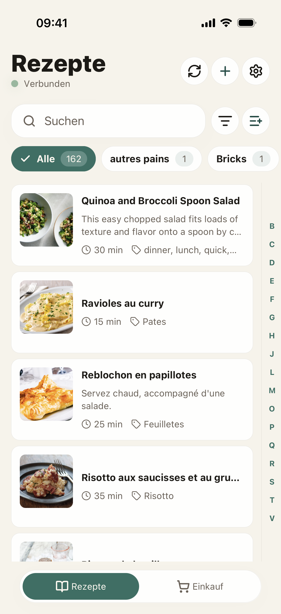
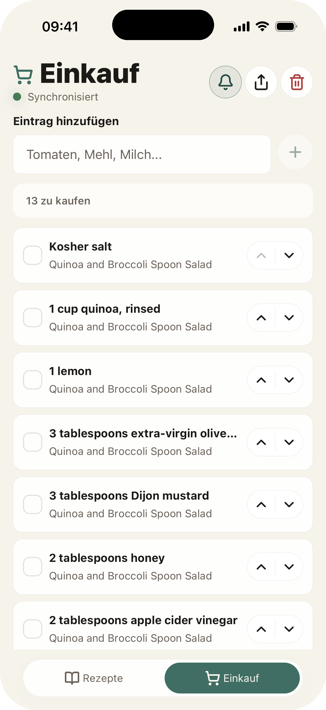

# AvoCook

[English](../../README.md) · [Français](../fr/README.md) · [Deutsch](README.md) · [Español](../es/README.md) · [Italiano](../it/README.md) · [Dansk](../da/README.md)

AvoCook ist eine kostenlose Open-Source-App für iOS und Android. Ich entwickle sie neben meinem Studium, um Rezepte zu sammeln, Mahlzeiten zu planen und mir das Kochen im Alltag etwas leichter zu machen.

[App Store](https://apps.apple.com/app/avocook/id6769012665) · [Google Play](https://play.google.com/store/apps/details?id=app.avocook.mobile) · [APK](https://github.com/Logarex/AvoCook/releases/latest)

[](https://github.com/Logarex/AvoCook/releases)

<p align="center">
  
  
  
</p>

## Funktionen

- Rezepte mit Fotos, Kategorien, anpassbaren Portionen, Webimport und optionalem Markdown.
- Vorräte in Kühlschrank, Schrank und Gefrierfach mit Strichcodes, Daten und Ablauf-Erinnerungen.
- Tages- und Wochenplanung, einfache Mahlzeiten, Reste, gespeicherte Menüs und Verlauf.
- Schrittweises Kochen, gespeicherte Timer, lokale Sprachbefehle und private Notizen.
- Ideen aus vorhandenen Zutaten, regionale Saisonkalender, Umrechnungen und Backalternativen.
- Lokale oder geteilte Einkaufslisten, Push-Mitteilungen, Nextcloud Pantry und Apple Erinnerungen unter iOS.
- Bebilderte PDF-Kochbücher, Rezepte teilen und vollständige Küchensicherungen.
- Community-Rezepte entdecken, übersetzen und teilen; optionaler Assistent mit eigenem API-Schlüssel.

Lokale Rezepte funktionieren offline ohne Konto. Nextcloud Cookbook ist optional; Planung, Vorräte und private Notizen bleiben auf dem Gerät.

## Anleitungen

- [Küchenanleitung](GUIDE.md)
- [Daten und Verbindungen](PRIVACY.md)
- [Technische Dokumentation](../LOCAL_KITCHEN.md) · [Nextcloud Pantry](../NEXTCLOUD_PANTRY.md) · [Seasonal catalog](../SEASONAL_CATALOG.md)

<details>
<summary>Entwicklung und Projektstruktur</summary>

## Entwicklungs-Setup

Das Projekt verwendet Expo SDK 57, React Native 0.86 und TypeScript. Node.js >=22.13 und <27 ist erforderlich. Lokale iOS-Builds verwenden Xcode 27 und Device Hub; die mindestens unterstützte iOS-Version ist 16.4.

```bash
npm ci
npm run ios      # iOS-Simulator
npm run android  # Android-Emulator
```

Nach Änderungen nativer Abhängigkeiten `npx expo prebuild --clean` ausführen und neu bauen. Lokale Sprachbefehle und Vorratserinnerungen benötigen die lokalen nativen Module; Expo Go reicht nicht aus.

Beim ersten Start wird ein Entwicklungs-Build mit nativen Modulen kompiliert. Danach öffnet sich die App direkt.

Die Projekte `ios/` und `android/` werden aus `app.json`, `tools/plugins/` und den lokalen Modulen in `src/modules/` generiert. Nach einem SDK-Update oder einer Änderung nativer Abhängigkeiten müssen sie vor dem nächsten Build mit `npx expo prebuild --clean` neu generiert werden. Das Plugin `expo-build-properties` aktiviert den von Xcode 27 benötigten UIKit-Szenen-Lebenszyklus.

Nützliche Befehle:

```bash
npm run typecheck                        # TypeScript-Prüfungen
npm test                                 # Unit-Tests (Vitest)
npm run lint                             # ESLint
npm run import:check -- <rezept-url>     # Einen Rezept-Import von einer URL testen
```

---

## Projektstruktur

```
src/
├── App.tsx                              # Einstiegspunkt, Navigation
├── screens/                             # Screens (Liste, Detail, Editor, Einstellungen…)
├── components/                          # Wiederverwendbare UI-Komponenten
├── features/
│   ├── kitchen/                         # Meine Küche — Alltagsmahlzeiten lokal planen
│   ├── community/                       # Firebase
│   ├── recipes/                         # Lokaler Speicher (SQLite), Rezeptlogik, Backup
│   ├── nextcloud/                       # HTTP-Client für Nextcloud Cookbook
│   ├── import/                          # Import per URL und Foto
│   ├── shopping/                        # Einkaufsliste und iOS-Erinnerungen-Sync
│   ├── timers/                          # Koch-Timer
│   ├── preferences/                     # App-Einstellungen
│   └── auth/                            # Nextcloud-Authentifizierung
├── i18n/                                # Internationalisierung (i18next, 6 Sprachen)
├── modules/
│   └── avocook-timer-notifications/     # Natives Modul für Timer-Benachrichtigungen
└── theme/                               # Farben, Typografie, geteilte Styles
tools/                                   # Build-Plugins, Import-Checker, Asset-Generator
docs/                                    # Dokumentation in anderen Sprachen (fr, de, es, it, da)
```

---

</details>

## Nextcloud Cookbook

So testest du die Synchronisierung:

1. Installiere die [Cookbook-App](https://apps.nextcloud.com/apps/cookbook) auf einer Nextcloud-Instanz.
2. Erstelle in den Sicherheitseinstellungen ein **App-Passwort** (Einstellungen → Sicherheit → Geräte und Sitzungen).
3. Gib in AvoCook (Einstellungen) die Server-URL, den Benutzernamen und das App-Passwort ein.

Ohne Protokollangabe wird standardmäßig HTTPS verwendet. Für einen Nextcloud-Server in deinem vertrauenswürdigen lokalen Netzwerk gib eine explizite HTTP-Adresse ein, etwa `http://192.168.1.50:8080/nextcloud` oder `http://nextcloud.local`. HTTP überträgt dein App-Passwort und deine Rezepte unverschlüsselt; verwende es nur in einem vertrauenswürdigen Netzwerk. Die Anmeldedaten bleiben im Geräteschlüsselbund verschlüsselt.

---

## Android

APKs werden in den [GitHub-Releases](https://github.com/Logarex/AvoCook/releases) veröffentlicht. Lade `avocook.apk` herunter und installiere es direkt.

---

## Mitmachen

Pull Requests sind willkommen. Siehe [CONTRIBUTING.md](../../.github/CONTRIBUTING.md) für die Richtlinien und die PR-Vorlage.

---

## Das Projekt unterstützen ☕

Wenn dir AvoCook nützlich ist, kannst du helfen, die Kosten zu decken:

**[→ Spenden via Revolut](https://revolut.me/logarex)** · **[→ Spenden via PayPal](https://paypal.me/logarex31)**

---

## Website

Die Website liegt in `site/`, die Texte in sechs Sprachen in `site/main.js`. Der folgende Befehl bereitet dieselben Dateien wie GitHub Pages vor, einschließlich Bildschirmbildern. Die Bereitstellung auf `gh-pages` erfolgt bei Pushes nach `main` oder über den manuellen Workflow Deploy site; ein Push nur auf diesen Branch veröffentlicht die Website nicht.

```bash
node tools/scripts/build-site.mjs
python3 -m http.server 8765 --bind 127.0.0.1 --directory dist/site
```

[http://127.0.0.1:8765/](http://127.0.0.1:8765/)

---

## Lizenz

Dieses Projekt ist unter der [GPLv3](../../LICENSE)-Lizenz lizenziert.
