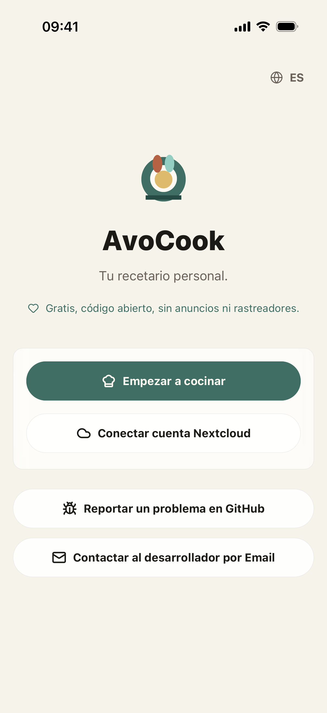

# AvoCook

[English](../../README.md) · [Français](../fr/README.md) · [Deutsch](../de/README.md) · [Español](README.md) · [Italiano](../it/README.md) · [Dansk](../da/README.md)

AvoCook es un compañero de cocina gratuito y de código abierto para iOS y Android, con o sin receta. Guarda recetas, organiza las comidas diarias, aprovecha los alimentos disponibles y prepara la compra. Las herramientas locales funcionan sin conexión ni crear una cuenta; la comunidad, las listas compartidas, las importaciones, la IA opcional y las conexiones Nextcloud utilizan servicios en línea.

Lo desarrollé para uso personal mientras aprendía a llevar un proyecto React Native completo de principio a fin.

[App Store](https://apps.apple.com/app/avocook/id6769012665) · [Google Play](https://play.google.com/store/apps/details?id=app.avocook.mobile) · [APK Android](https://github.com/Logarex/AvoCook/releases/latest) · [](https://github.com/Logarex/AvoCook/releases)

<div align="center">
  
  
</div>

## Novedades de la versión 5.0.0

Cinco pestañas: Recetas, Mi cocina, Plan, Comunidad y Compra. Mi cocina reúne alimentos e ideas; Plan se abre en Hoy y también ofrece la semana.

- **Tus alimentos, bien ordenados** — Nevera, despensa y congelador con búsqueda, cantidades y fechas. Escanea un código de barras o escribe el alimento. Nutri-Score y Green-Score de Open Food Facts cuando estén disponibles; avisos locales opcionales.
- **Un plan de comidas propio** — Organiza Hoy y la semana: recetas, comidas sencillas, sobras o salidas. Ajusta raciones, mueve comidas y prepara la compra. También hay menús reutilizables y preparación de varias recetas.
- **Cocina y guarda tus hábitos** — Sigue los pasos con temporizadores y comandos de voz locales compatibles. Guarda notas, preparaciones y comidas habituales en el diario privado y el historial. Los temporizadores se restauran sin avisos duplicados.
- **Herramientas para cada día** — Calendarios de temporada con fuentes para 11 países y límites regionales, conversiones y sustituciones según el uso. Crea un recetario PDF y guarda recetas junto con los datos privados de Mi cocina.
- **Una idea con tus ingredientes** — Escribe ingredientes o analiza una foto, corrige la lista y genera un borrador editable. IA opcional con tu proveedor, clave API y un modelo compatible; puede haber costes.
- **Una interfaz más ligera** — Acciones de recetas y compra compactas, alimentos agrupados por lugar y detalles al tocar. Categorías más pequeñas y vistas adaptadas al tamaño de pantalla y texto.

Introduce la fecha del envase. Pueden faltar fichas y puntuaciones, que no constituyen un análisis completo del producto. La búsqueda necesita Internet; los alimentos y el plan se guardan localmente. Los avisos dependen de los permisos del dispositivo.

## Funcionalidades

### Plataforma de la Comunidad

- Descubre, califica e importa recetas de la comunidad AvoCook;
- Las recetas de la comunidad se muestran automáticamente en el idioma de la aplicación, tanto en la lista como en los detalles;
- Consulta la receta original en cualquier momento o importa la versión traducida a tu recetario;
- Comparte tus mejores comidas configurando un perfil de la comunidad;
- Incluye denuncias comunitarias y controles antispam; los contenidos publicados proceden de los usuarios.
- Elige otro idioma para la traducción comunitaria, incluidos chino, portugués, neerlandés, japonés, coreano, árabe y ruso. Las recetas cargadas y traducciones correctas se guardan para leer sin conexión.

### Recetas

- Crear y editar recetas localmente, sin cuenta;
- Organizar recetas por categoría;
- Ajustar las cantidades según el número de raciones;
- Añadir una o varias fotos a cada receta;
- Exportar una receta en PDF o imprimirla directamente;
- Compartir una receta con otra aplicación.

### Mi cocina — comidas diarias, en local

Cinco pestañas: Recetas, Mi cocina, Plan, Comunidad y Compra. Mi cocina reúne alimentos e ideas; Plan se abre en Hoy y también ofrece la semana.

- **Organiza la semana** — Añade comidas y cenas, arrastra recetas entre días y ajusta las raciones. Revisa los ingredientes agrupados antes de añadirlos a la compra.
- **Comidas sin receta** — Anota una comida rápida, repite una habitual o planifica sobras y salidas. Solo las comidas con ingredientes aportan productos a la compra.
- **Aprovecha lo que tienes** — Guarda alimentos de nevera, despensa y congelador con sus fechas. Encuentra recetas con menos ingredientes que falten y revisa las compras. Recordatorios locales de fechas opcionales.
- **Frutas y verduras de temporada** — Elige zona y mes, busca o filtra y selecciona productos para la compra o ideas de recetas. Calendarios sin conexión con fuentes y cobertura regional explícita.
- **Cocina paso a paso** — Un paso en letra grande, progreso, ingredientes y temporizadores. Órdenes de voz locales opcionales si son compatibles; avisos según permisos y ajustes del dispositivo.
- **Una receta con tu nevera (IA)** — Escribe ingredientes o analiza una foto, corrige los alimentos reconocidos y genera un borrador editable. Opcional: tu clave API y un modelo adecuado; el proveedor puede cobrar las consultas.
- **Un diario de cocina privado** — Valoraciones, notas, cambios, fechas de preparación, dificultad y costes introducidos a mano. Las etiquetas alimentarias y filtros personales ayudan a ordenar; no certifican la ausencia de alérgenos.
- **Batch cooking y menús** — Elige de 3 a 5 recetas, agrupa la compra y revisa tareas de preparación por duración. Guarda y planifica menús de fiesta; sin cocinar en paralelo automáticamente.
- **Tu propio libro de recetas** — Selecciona hasta 50 recetas para un PDF de texto local con índice, ingredientes y pasos. No incluye notas privadas ni fotos.
- **Herramientas prácticas** — Elige una receta sorpresa, convierte unidades compatibles y temperaturas o consulta sustituciones de repostería según la preparación, con proporciones y precauciones. Sin inventar conversiones entre gramos y mililitros.
- **Copias bajo tu control** — Exporta recetas a JSON o usa la copia completa de Mi cocina para recetas, fotos locales disponibles y planificación privada. Revisa antes de restaurar.

Calendarios disponibles: Francia metropolitana, Valonia (Bélgica), Suiza, Alemania, España, Italia, Reino Unido, Dinamarca, Ontario (Canadá), estado de Nueva York (EE. UU.) y Sídney (Australia). Son 11 países con límites regionales, no cobertura mundial. Las fuentes distinguen cosecha, conservación o disponibilidad comercial; son orientaciones, no previsiones en tiempo real.

La búsqueda por ingredientes no comprueba cantidades disponibles, frescura ni alérgenos. El usuario introduce las etiquetas alimentarias. Las sustituciones se limitan a preparaciones compatibles. Voz y notificaciones dependen del dispositivo y los permisos.

[Funcionamiento y límites](../LOCAL_KITCHEN.md) · [Fuentes del catálogo de temporada](../SEASONAL_CATALOG.md)

Filtra ideas por duración conocida (≤30 minutos), valoración personal (≥4/5), dificultad fácil y etiquetas alimentarias personales. El historial guarda comidas confirmadas como consumidas y preparaciones registradas en el diario o modo cocina.

### Markdown opcional

Todos los campos de texto de las recetas admiten Markdown, en cualquier idioma: nombre, descripción, categoría, palabras clave, nombre de la fuente, ingredientes, instrucciones, utensilios y valores nutricionales. El texto sin formato sigue siendo la opción predeterminada; no hace falta conocer Markdown.

Utiliza `**negrita**`, `*cursiva*`, títulos, listas, citas, código, tablas o `[un enlace](https://example.com)`. El formato aparece al leer recetas, en los PDF y al imprimir. Las imágenes Markdown aparecen como enlaces. Los números (raciones y duraciones) y los campos URL conservan su formato habitual.

Cada ingrediente e instrucción conserva su Markdown, incluidos párrafos y listas anidadas. Pegar líneas de texto simple sigue creando elementos separados; pegar un bloque Markdown lo mantiene unido.

### Importación

- Importa desde páginas compatibles con datos `schema.org/Recipe` accesibles; algunos sitios bloquean la extracción o proporcionan datos incompletos.
- Recibir una URL compartida desde un navegador u otra app para importar una receta con un toque;
- IA opcional: escanea recetas, genera desde texto o una foto de un plato, o crea un borrador con tu nevera. Elige OpenAI, Gemini, Groq, Grok, Mistral, Claude o un punto de acceso personalizado en los ajustes del Asistente. Requiere tu clave API y un modelo compatible; las fotos necesitan visión y el proveedor puede cobrar las consultas.

### Lista de la compra

- Elige compra local, uso compartido AvoCook o Nextcloud Pantry, con traslado de artículos al cambiar. La sincronización opcional con Recordatorios iOS funciona en los tres modos. [Nextcloud Pantry](../NEXTCLOUD_PANTRY.md).
- Comparte listas de compras con un código de 6 caracteres, un contador de participantes y avisos locales mientras AvoCook está en ejecución;
- Copiar los ingredientes al portapapeles con un toque;
- Exportar una lista de la compra a Recordatorios de iOS para aprovechar el sistema de compartir de Apple y la integración con Siri.

### Temporizadores

- Iniciar uno o varios temporizadores de cocina directamente desde una receta;
- Los avisos locales de temporizadores pueden funcionar en segundo plano según los permisos y ajustes del sistema; comprueba la recepción en tu dispositivo.

### Datos y sincronización

- Hacer una copia de seguridad de todas las recetas en un archivo JSON y restaurarlas;
- **Opcional**: conectar un servidor Nextcloud Cookbook para sincronizar recetas entre dispositivos. Los datos van directamente entre la app y tu servidor, sin pasar por ningún servicio de terceros.

> Las recetas locales se quedan en el dispositivo salvo que las sincronices, compartas o exportes. La comunidad usa Firebase con una sesión anónima al iniciar. Consulta [Privacidad y datos](PRIVACY.md).

> Este README describe la rama de código actual. Las versiones de las tiendas y las publicaciones GitHub pueden no incluir aún los últimos cambios.

---

## Idiomas disponibles

Francés · Inglés · Alemán · Español · Italiano · Danés

---

## Configuración de desarrollo

El proyecto utiliza Expo SDK 57, React Native 0.86 y TypeScript. Se requiere Node.js >=22.13 y <27. Las compilaciones locales de iOS utilizan Xcode 27 y Device Hub; la versión mínima de iOS compatible es 16.4.

```bash
npm ci
npm run ios      # Simulador iOS
npm run android  # Emulador Android
```

Tras cambiar dependencias nativas, ejecuta `npx expo prebuild --clean` y recompila. La voz local y los recordatorios de alimentos requieren los módulos nativos locales; Expo Go no basta.

En el primer inicio se compila una build de desarrollo con módulos nativos. Después, la app se abre directamente.

Los proyectos `ios/` y `android/` se generan a partir de `app.json`, `tools/plugins/` y los módulos locales de `src/modules/`. Después de actualizar el SDK o las dependencias nativas, vuelve a generarlos con `npx expo prebuild --clean` antes de compilar. El plugin `expo-build-properties` activa el ciclo de vida de UIKit basado en escenas que requiere Xcode 27.

Comandos útiles:

```bash
npm run typecheck                      # Verificaciones TypeScript
npm test                               # Tests unitarios (Vitest)
npm run lint                           # ESLint
npm run import:check -- <url-receta>   # Probar la importación desde una URL
```

---

## Estructura del proyecto

```
src/
├── App.tsx                              # Punto de entrada, navegación
├── screens/                             # Pantallas (lista, detalle, editor, ajustes…)
├── components/                          # Componentes de UI reutilizables
├── features/
│   ├── kitchen/                         # Mi cocina — comidas diarias, en local
│   ├── community/                       # Firebase
│   ├── recipes/                         # Almacenamiento local (SQLite), lógica recetas, backup
│   ├── nextcloud/                       # Cliente HTTP para Nextcloud Cookbook
│   ├── import/                          # Importación por URL y foto
│   ├── shopping/                        # Lista de la compra y sync con Recordatorios iOS
│   ├── timers/                          # Temporizadores de cocina
│   ├── preferences/                     # Configuración de la aplicación
│   └── auth/                            # Autenticación Nextcloud
├── i18n/                                # Internacionalización (i18next, 6 idiomas)
├── modules/
│   └── avocook-timer-notifications/     # Módulo nativo para notificaciones de temporizador
└── theme/                               # Colores, tipografía, estilos compartidos
tools/                                   # Plugins de build, verificador de importación, assets
docs/                                    # Documentación en otros idiomas (fr, de, es, it, da)
```

---

## Nextcloud Cookbook

Para probar la sincronización:

1. Instala la [aplicación Cookbook](https://apps.nextcloud.com/apps/cookbook) en una instancia de Nextcloud.
2. Crea una **contraseña de aplicación** en la configuración de seguridad (Ajustes → Seguridad → Dispositivos y sesiones).
3. En AvoCook (Ajustes), introduce la URL del servidor, el nombre de usuario y esa contraseña.

Se usa HTTPS por defecto si no se indica un protocolo. Para un servidor Nextcloud en tu red local de confianza, introduce una dirección HTTP explícita, como `http://192.168.1.50:8080/nextcloud` o `http://nextcloud.local`. HTTP envía tu contraseña de aplicación y tus recetas sin cifrar; úsalo solo en una red de confianza. Las credenciales siguen cifradas en el llavero del dispositivo.

---

## Android

Los APK se publican en las [releases de GitHub](https://github.com/Logarex/AvoCook/releases). Descarga `avocook.apk` e instálalo directamente.

---

## Contribuir

Las pull requests son bienvenidas. Consulta [CONTRIBUTING.md](../../.github/CONTRIBUTING.md) para las pautas y la plantilla de PR.

---

## Apoyar el proyecto ☕

Si AvoCook te resulta útil, puedes ayudar a cubrir los costes:

**[→ Donar vía Revolut](https://revolut.me/logarex)** · **[→ Donar vía PayPal](https://paypal.me/logarex31)**

---

## Sitio web

La web está en `site/`, con textos en seis idiomas en `site/main.js`. El comando siguiente prepara los mismos archivos que GitHub Pages, incluidas las capturas. Se publica en `gh-pages` al enviar cambios a `main` o mediante el workflow manual Deploy site; enviar solo esta rama no publica la web.

```bash
node tools/scripts/build-site.mjs
python3 -m http.server 8765 --bind 127.0.0.1 --directory dist/site
```

[http://127.0.0.1:8765/](http://127.0.0.1:8765/)

---

## Licencia

Este proyecto está bajo la licencia [GPLv3](../../LICENSE).
