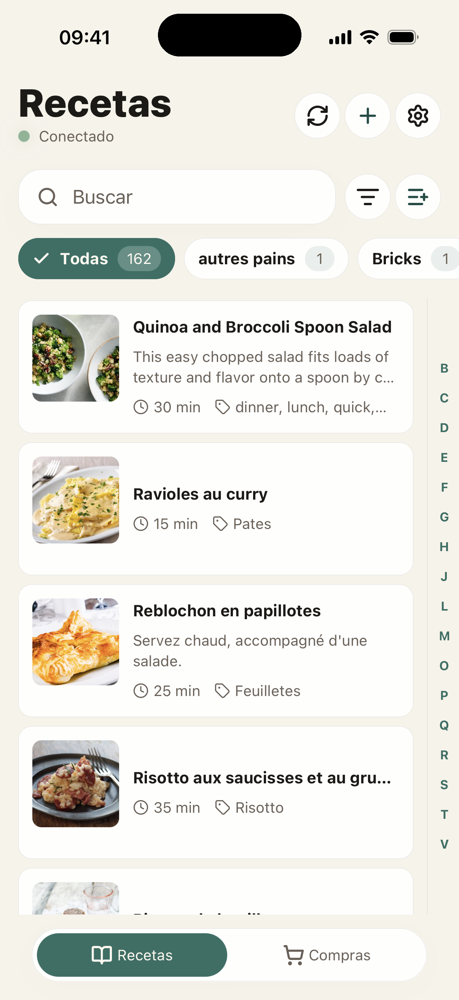
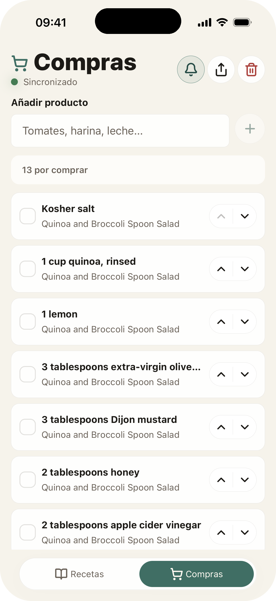

# AvoCook

[English](../../README.md) · [Français](../fr/README.md) · [Deutsch](../de/README.md) · [Español](README.md) · [Italiano](../it/README.md) · [Dansk](../da/README.md)

AvoCook es una aplicación gratuita y de código abierto para iOS y Android. La desarrollo mientras estudio para guardar mis recetas, planificar comidas y facilitarme un poco la cocina de cada día.

[App Store](https://apps.apple.com/app/avocook/id6769012665) · [Google Play](https://play.google.com/store/apps/details?id=app.avocook.mobile) · [APK](https://github.com/Logarex/AvoCook/releases/latest)

[](https://github.com/Logarex/AvoCook/releases)

<p align="center">
  
  
  
</p>

## Funciones

- Recetas con fotos, categorías, raciones ajustables, importación web y Markdown opcional.
- Nevera, despensa y congelador con códigos de barras, fechas y avisos de caducidad.
- Plan diario y semanal, comidas sencillas, sobras, menús guardados e historial.
- Cocina paso a paso, temporizadores guardados, comandos de voz locales y notas privadas.
- Ideas con tus ingredientes, calendarios regionales de temporada, conversiones y sustituciones de repostería.
- Listas locales o compartidas, notificaciones, Nextcloud Pantry y Recordatorios de Apple en iOS.
- Recetarios PDF ilustrados, recetas para compartir y copias completas de tu cocina.
- Recetas de la comunidad para descubrir, traducir y compartir; asistente opcional con tu clave API.

Las recetas locales funcionan sin conexión ni cuenta. Nextcloud Cookbook es opcional; plan, alimentos y notas privadas permanecen en el dispositivo.

## Guías

- [Guía de cocina](GUIDE.md)
- [Tus datos y conexiones](PRIVACY.md)
- [Documentación técnica](../LOCAL_KITCHEN.md) · [Nextcloud Pantry](../NEXTCLOUD_PANTRY.md) · [Seasonal catalog](../SEASONAL_CATALOG.md)

<details>
<summary>Desarrollo y estructura del proyecto</summary>

## Configuración de desarrollo

El proyecto utiliza Expo SDK 57, React Native 0.86 y TypeScript. Se requiere Node.js >=22.13 y <27. Las compilaciones locales de iOS utilizan Xcode 27 y Device Hub; la versión mínima de iOS compatible es 16.4.

```bash
npm ci
npm run ios      # Simulador iOS
npm run android  # Emulador Android
```

Tras cambiar dependencias nativas, ejecuta `npx expo prebuild --clean` y recompila. La voz local y los recordatorios de alimentos requieren los módulos nativos locales; Expo Go no basta.

En el primer inicio se compila una build de desarrollo con módulos nativos. Después, la app se abre directamente.

Los proyectos `ios/` y `android/` se generan a partir de `app.json`, `tools/plugins/` y los módulos locales de `src/modules/`. Después de actualizar el SDK o las dependencias nativas, vuelve a generarlos con `npx expo prebuild --clean` antes de compilar. El plugin `expo-build-properties` activa el ciclo de vida de UIKit basado en escenas que requiere Xcode 27.

Comandos útiles:

```bash
npm run typecheck                      # Verificaciones TypeScript
npm test                               # Tests unitarios (Vitest)
npm run lint                           # ESLint
npm run import:check -- <url-receta>   # Probar la importación desde una URL
```

---

## Estructura del proyecto

```
src/
├── App.tsx                              # Punto de entrada, navegación
├── screens/                             # Pantallas (lista, detalle, editor, ajustes…)
├── components/                          # Componentes de UI reutilizables
├── features/
│   ├── kitchen/                         # Mi cocina — comidas diarias, en local
│   ├── community/                       # Firebase
│   ├── recipes/                         # Almacenamiento local (SQLite), lógica recetas, backup
│   ├── nextcloud/                       # Cliente HTTP para Nextcloud Cookbook
│   ├── import/                          # Importación por URL y foto
│   ├── shopping/                        # Lista de la compra y sync con Recordatorios iOS
│   ├── timers/                          # Temporizadores de cocina
│   ├── preferences/                     # Configuración de la aplicación
│   └── auth/                            # Autenticación Nextcloud
├── i18n/                                # Internacionalización (i18next, 6 idiomas)
├── modules/
│   └── avocook-timer-notifications/     # Módulo nativo para notificaciones de temporizador
└── theme/                               # Colores, tipografía, estilos compartidos
tools/                                   # Plugins de build, verificador de importación, assets
docs/                                    # Documentación en otros idiomas (fr, de, es, it, da)
```

---

</details>

## Nextcloud Cookbook

Para probar la sincronización:

1. Instala la [aplicación Cookbook](https://apps.nextcloud.com/apps/cookbook) en una instancia de Nextcloud.
2. Crea una **contraseña de aplicación** en la configuración de seguridad (Ajustes → Seguridad → Dispositivos y sesiones).
3. En AvoCook (Ajustes), introduce la URL del servidor, el nombre de usuario y esa contraseña.

Se usa HTTPS por defecto si no se indica un protocolo. Para un servidor Nextcloud en tu red local de confianza, introduce una dirección HTTP explícita, como `http://192.168.1.50:8080/nextcloud` o `http://nextcloud.local`. HTTP envía tu contraseña de aplicación y tus recetas sin cifrar; úsalo solo en una red de confianza. Las credenciales siguen cifradas en el llavero del dispositivo.

---

## Android

Los APK se publican en las [releases de GitHub](https://github.com/Logarex/AvoCook/releases). Descarga `avocook.apk` e instálalo directamente.

---

## Contribuir

Las pull requests son bienvenidas. Consulta [CONTRIBUTING.md](../../.github/CONTRIBUTING.md) para las pautas y la plantilla de PR.

---

## Apoyar el proyecto ☕

Si AvoCook te resulta útil, puedes ayudar a cubrir los costes:

**[→ Donar vía Revolut](https://revolut.me/logarex)** · **[→ Donar vía PayPal](https://paypal.me/logarex31)**

---

## Sitio web

La web está en `site/`, con textos en seis idiomas en `site/main.js`. El comando siguiente prepara los mismos archivos que GitHub Pages, incluidas las capturas. Se publica en `gh-pages` al enviar cambios a `main` o mediante el workflow manual Deploy site; enviar solo esta rama no publica la web.

```bash
node tools/scripts/build-site.mjs
python3 -m http.server 8765 --bind 127.0.0.1 --directory dist/site
```

[http://127.0.0.1:8765/](http://127.0.0.1:8765/)

---

## Licencia

Este proyecto está bajo la licencia [GPLv3](../../LICENSE).
