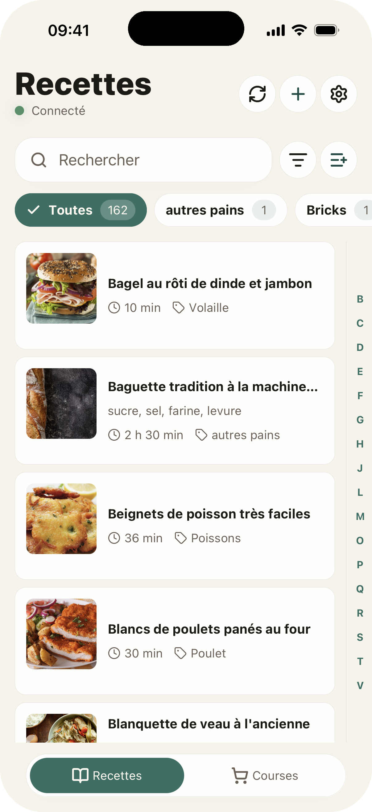
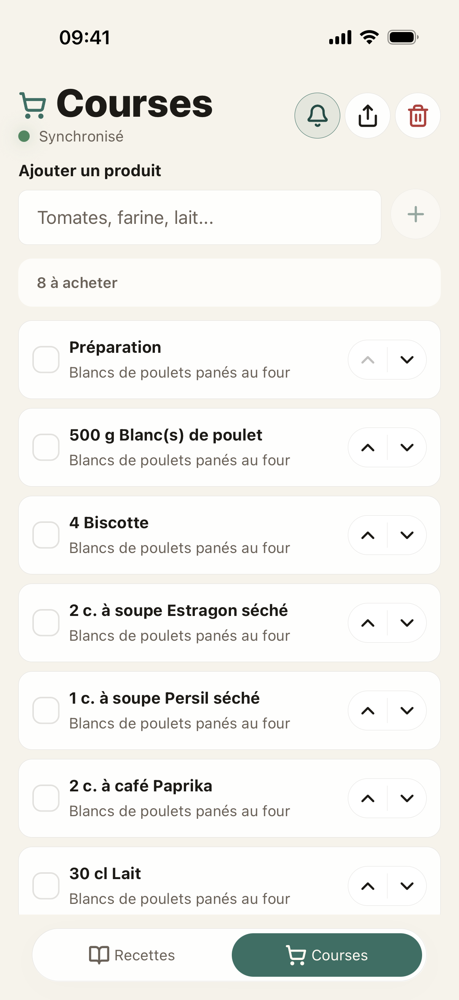

# AvoCook

[English](../../README.md) · [Français](README.md) · [Deutsch](../de/README.md) · [Español](../es/README.md) · [Italiano](../it/README.md) · [Dansk](../da/README.md)

AvoCook est une application gratuite et open source pour iOS et Android. Je la développe à côté de mes études pour garder mes recettes, prévoir mes repas et me faciliter un peu la cuisine au quotidien.

[App Store](https://apps.apple.com/app/avocook/id6769012665) · [Google Play](https://play.google.com/store/apps/details?id=app.avocook.mobile) · [APK](https://github.com/Logarex/AvoCook/releases/latest)

[](https://github.com/Logarex/AvoCook/releases)

<p align="center">
  
  
  
</p>

## Fonctionnalités

- Recettes avec photos, catégories, portions ajustables, import web et Markdown facultatif.
- Réserves du frigo, du placard et du congélateur, avec codes-barres, dates et rappels de péremption.
- Planning du jour et de la semaine, repas simples, restes, menus enregistrés et historique.
- Cuisine étape par étape, minuteurs sauvegardés, commandes vocales locales et notes privées.
- Idées avec vos ingrédients, calendriers de saison régionaux, conversions et substitutions de pâtisserie.
- Courses locales ou partagées, notifications, Nextcloud Pantry et Rappels Apple sur iOS.
- Livres PDF illustrés, partage de recettes et sauvegardes complètes de votre cuisine.
- Recettes communautaires à découvrir, traduire et partager ; assistant facultatif avec votre clé API.

Les recettes locales fonctionnent hors ligne sans compte. Nextcloud Cookbook reste facultatif ; le planning, les réserves et les notes privées restent sur l’appareil.

## Guides

- [Guide de la cuisine](GUIDE.md)
- [Vos données et vos connexions](PRIVACY.md)
- [Documentation technique](../LOCAL_KITCHEN.md) · [Nextcloud Pantry](../NEXTCLOUD_PANTRY.md) · [Seasonal catalog](../SEASONAL_CATALOG.md)

<details>
<summary>Développement et structure du projet</summary>

## Configuration pour le développement

Le projet utilise Expo SDK 57, React Native 0.86 et TypeScript. Node.js >=22.13 et <27 est requis. Les builds iOS locaux utilisent Xcode 27 et Device Hub ; la version minimale d'iOS prise en charge est 16.4.

Les builds Android locaux nécessitent JDK 17 et Android SDK 36. Définissez `JAVA_HOME` vers votre installation de JDK 17 si votre système utilise encore une version plus ancienne de Java par défaut.

```bash
npm ci
npm run ios      # Simulateur iOS
npm run android  # Émulateur Android
```

Après modification des dépendances natives, lancez `npx expo prebuild --clean` et recompilez. Les commandes vocales locales et rappels de stock nécessitent les modules natifs locaux ; Expo Go ne suffit pas.

Un build de développement avec les modules natifs est compilé au premier lancement. Ensuite, l'application s'ouvre directement.

Les projets `ios/` et `android/` sont générés à partir de `app.json`, de `tools/plugins/` et des modules locaux de `src/modules/`. Après une mise à jour du SDK ou des dépendances natives, régénérez-les avec `npx expo prebuild --clean` avant de compiler à nouveau. Le plugin `expo-build-properties` active le cycle de vie UIKit fondé sur les scènes, requis par Xcode 27.

Commandes utiles :

```bash
npm run typecheck                       # Vérifications TypeScript
npm test                                # Tests unitaires (Vitest)
npm run lint                            # ESLint
npm run import:check -- <url-recette>   # Tester l'import depuis une URL
```

---

## Structure du projet

```
src/
├── App.tsx                              # Point d'entrée, navigation
├── screens/                             # Écrans (liste, détail, éditeur, paramètres…)
├── components/                          # Composants UI réutilisables
├── features/
│   ├── kitchen/                         # Ma cuisine — les repas du quotidien, en local
│   ├── community/                       # Firebase
│   ├── recipes/                         # Stockage local (SQLite), logique recettes, backup
│   ├── nextcloud/                       # Client HTTP pour Nextcloud Cookbook
│   ├── import/                          # Import depuis URL et photo
│   ├── shopping/                        # Liste de courses et synchronisation Rappels iOS
│   ├── timers/                          # Minuteurs de cuisson
│   ├── preferences/                     # Paramètres de l'application
│   └── auth/                            # Authentification Nextcloud
├── i18n/                                # Internationalisation (i18next, 6 langues)
├── modules/
│   └── avocook-timer-notifications/     # Module natif pour les notifications minuteur
└── theme/                               # Couleurs, typographie, styles partagés
tools/                                   # Plugins de build, vérificateur d'import, assets
docs/                                    # Documentation dans d'autres langues (fr, de, es, it, da)
```

---

</details>

## Nextcloud Cookbook

Pour tester la synchronisation :

1. Installez l'[application Cookbook](https://apps.nextcloud.com/apps/cookbook) sur une instance Nextcloud.
2. Créez un **mot de passe d'application** dans les paramètres de sécurité (Paramètres → Sécurité → Appareils et sessions).
3. Dans AvoCook, allez dans les paramètres et entrez l'URL du serveur, le nom d'utilisateur et ce mot de passe.

HTTPS est utilisé par défaut si aucun protocole n'est indiqué. Pour un serveur Nextcloud sur votre réseau local de confiance, saisissez une adresse HTTP explicite, comme `http://192.168.1.50:8080/nextcloud` ou `http://nextcloud.local`. HTTP transmet votre mot de passe d'application et vos recettes sans chiffrement ; utilisez-le uniquement sur un réseau de confiance. Les identifiants restent chiffrés dans le trousseau de l'appareil.

---

## Android

Les APK sont publiés dans les [releases GitHub](https://github.com/Logarex/AvoCook/releases). Téléchargez `avocook.apk` et installez-le directement.

---

## Contribuer

Les pull requests sont les bienvenues. Consultez [CONTRIBUTING.md](../../.github/CONTRIBUTING.md) pour les conventions et le modèle de PR.

---

## Soutenir le projet ☕

Si AvoCook vous est utile, vous pouvez aider à couvrir les frais :

**[→ Faire un don via Revolut](https://revolut.me/logarex)** · **[→ Faire un don via PayPal](https://paypal.me/logarex31)**

---

## Site web

La vitrine est dans `site/`, avec les textes en six langues dans `site/main.js`. La commande ci-dessous prépare les mêmes fichiers que GitHub Pages, captures comprises. Le site est déployé sur `gh-pages` lors des envois vers `main`, ou via le workflow manuel Deploy site ; un envoi sur cette branche seule ne le publie pas.

```bash
node tools/scripts/build-site.mjs
python3 -m http.server 8765 --bind 127.0.0.1 --directory dist/site
```

[http://127.0.0.1:8765/](http://127.0.0.1:8765/)

---

## Licence

Ce projet est sous licence [GPLv3](../../LICENSE).
