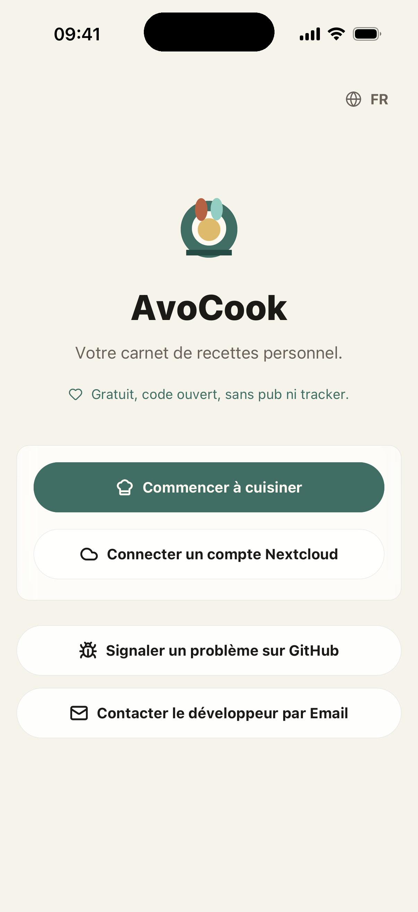
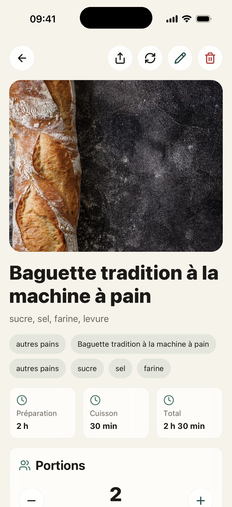

# AvoCook

[English](../../README.md) · [Français](README.md) · [Deutsch](../de/README.md) · [Español](../es/README.md) · [Italiano](../it/README.md) · [Dansk](../da/README.md)

AvoCook est un compagnon de cuisine gratuit et open source pour iOS et Android, avec ou sans recette. Retrouvez vos recettes, organisez les repas du quotidien, utilisez vos aliments disponibles et préparez vos courses. Les outils locaux fonctionnent hors ligne sans créer de compte ; la communauté, les listes partagées, les imports, l’IA facultative et les connexions Nextcloud utilisent des services en ligne.

Je l'ai développé pour mon usage personnel en apprenant à mener un projet React Native complet de bout en bout.

[App Store](https://apps.apple.com/app/avocook/id6769012665) · [Google Play](https://play.google.com/store/apps/details?id=app.avocook.mobile) · [APK Android](https://github.com/Logarex/AvoCook/releases/latest) · [](https://github.com/Logarex/AvoCook/releases)

<div align="center">
  
  
</div>

> Ce README décrit la branche source actuelle. Les versions des boutiques et des releases GitHub peuvent ne pas encore inclure ses dernières modifications.

---

## Nouveautés de la version 5.0.0

Cinq onglets : Recettes, Ma cuisine, Planning, Communauté et Courses. Ma cuisine rassemble les réserves et les idées ; Planning s’ouvre sur Aujourd’hui et donne accès à la semaine.

- **Vos réserves, bien rangées** — Frigo, placard et congélateur, recherche, quantités et dates. Scannez un code-barres ou saisissez un aliment. Nutri-Score et Green-Score d’Open Food Facts lorsqu’ils sont disponibles ; rappels locaux facultatifs.
- **Un planning à part entière** — Organisez Aujourd’hui et la semaine : recettes, repas simples, restes ou sorties. Ajustez les portions, déplacez les repas et préparez les courses. Menus réutilisables et préparation de plusieurs recettes restent accessibles.
- **Cuisiner et garder ses habitudes** — Suivez les étapes avec les minuteurs et les commandes vocales locales compatibles. Retrouvez vos notes, préparations et repas habituels dans le carnet privé et l’historique. Les minuteurs sont restaurés sans alertes en double.
- **Des outils pour le quotidien** — Calendriers de saison sourcés pour 11 pays, avec limites régionales, conversions et substitutions selon l’usage. Créez un livre PDF et sauvegardez les recettes avec les données privées de Ma cuisine.
- **Une idée avec vos ingrédients** — Saisissez vos ingrédients ou analysez une photo, corrigez la liste puis générez un brouillon modifiable. IA facultative, avec votre fournisseur, votre clé API et un modèle compatible ; des frais peuvent s’appliquer.
- **Une interface plus légère** — Actions de recettes et courses plus compactes, produits regroupés par rangement et détails à la demande. Catégories plus discrètes et présentation adaptée à la taille de l’écran et du texte.

La date du paquet reste à saisir. Les fiches et scores peuvent manquer et ne constituent pas une analyse complète du produit. La recherche produit utilise Internet ; les réserves et le planning restent locaux. Les notifications dépendent des autorisations de l’appareil.

## Fonctionnalités

### Plateforme Communautaire

- Découvrez, notez et importez des recettes de la communauté AvoCook ;
- Les recettes de la communauté s’affichent automatiquement dans la langue de l’application, dans la liste comme dans le détail ;
- Consultez l’original à tout moment ou importez la version traduite dans votre carnet de recettes ;
- Partagez vos meilleurs plats en créant un profil communautaire ;
- Signalements communautaires et contrôles antispam intégrés ; les contenus publiés sont proposés par les utilisateurs.
- Choisissez une langue de traduction communautaire distincte, dont le chinois, le portugais, le néerlandais, le japonais, le coréen, l’arabe et le russe. Les recettes chargées et traductions réussies sont mises en cache pour la lecture hors ligne.

### Recettes

- Créer et modifier des recettes localement, sans compte ;
- Organiser les recettes par catégorie ;
- Ajuster les quantités selon le nombre de portions ;
- Ajouter une ou plusieurs photos à chaque recette ;
- Exporter une recette en PDF ou l'imprimer directement ;
- Partager une recette vers une autre application.

### Ma cuisine — les repas du quotidien, en local

Cinq onglets : Recettes, Ma cuisine, Planning, Communauté et Courses. Ma cuisine rassemble les réserves et les idées ; Planning s’ouvre sur Aujourd’hui et donne accès à la semaine.

- **Organiser la semaine** — Ajoutez les déjeuners et dîners, glissez les recettes entre les jours et ajustez les portions. Vérifiez les ingrédients regroupés avant de les ajouter aux courses.
- **Des repas sans recette** — Notez un repas rapide, reprenez un repas habituel ou prévoyez des restes et une sortie. Seuls les repas avec des ingrédients alimentent les courses.
- **Utiliser ce que vous avez** — Enregistrez les aliments du frigo, des placards et du congélateur avec leurs dates. Trouvez les recettes avec le moins d’ingrédients manquants et vérifiez les achats. Rappels locaux de dates facultatifs.
- **Fruits et légumes de saison** — Choisissez une zone et un mois, filtrez ou recherchez, puis sélectionnez des produits pour les courses ou des idées de recettes. Calendriers hors ligne sourcés, avec couverture régionale explicite.
- **Cuisiner étape par étape** — Une étape en gros caractères, la progression, les ingrédients et les minuteurs. Commandes vocales locales facultatives si compatibles ; alertes selon les autorisations et réglages de l’appareil.
- **Une recette avec mon frigo (IA)** — Saisissez des ingrédients ou analysez une photo, corrigez les aliments reconnus, puis générez un brouillon modifiable. Facultatif : votre clé API et un modèle adapté ; le fournisseur peut facturer les requêtes.
- **Un carnet de cuisine privé** — Notes sur 5, commentaires, modifications, dates de préparation, difficulté et coûts saisis à la main. Les étiquettes alimentaires et filtres personnels aident à classer les recettes ; ils ne certifient pas l’absence d’allergènes.
- **Batch cooking et menus** — Choisissez 3 à 5 recettes, regroupez les courses et consultez les tâches de préparation dans l’ordre des durées. Enregistrez et planifiez des menus de fête ; sans cuisson parallèle automatique.
- **Votre livre de recettes** — Sélectionnez jusqu’à 50 recettes pour un PDF texte local avec sommaire, ingrédients et étapes. Les notes privées et les photos en sont exclues.
- **Des outils pratiques en cuisine** — Tirez une recette surprise, convertissez des unités compatibles et températures, ou consultez des substitutions de pâtisserie adaptées à la préparation, avec proportions et précautions. Pas de conversion inventée entre grammes et millilitres.
- **Des sauvegardes à garder** — Exportez vos recettes en JSON, ou utilisez la sauvegarde complète Ma cuisine pour les recettes, photos locales disponibles et données privées du planning. Vérifiez avant de restaurer.

Calendriers disponibles : France métropolitaine, Wallonie (Belgique), Suisse, Allemagne, Espagne, Italie, Royaume-Uni, Danemark, Ontario (Canada), État de New York (États-Unis) et Sydney (Australie). Soit 11 pays avec des limites régionales, et non une couverture mondiale. Les sources distinguent récolte, conservation ou disponibilité commerciale ; ce sont des repères, pas des prévisions de disponibilité en temps réel.

La recherche par ingrédients ne vérifie ni les quantités disponibles, ni la fraîcheur, ni les allergènes. Les étiquettes alimentaires sont saisies par l’utilisateur. Les substitutions se limitent aux préparations prises en charge. Commandes vocales et notifications dépendent de l’appareil et des autorisations.

[Fonctionnement et limites](../LOCAL_KITCHEN.md) · [Sources du catalogue de saison](../SEASONAL_CATALOG.md)

Filtrez les idées de repas par durée connue (≤30 minutes), note personnelle (≥4/5), difficulté facile et étiquettes alimentaires personnelles. L’historique conserve les repas confirmés comme mangés et les préparations enregistrées dans le carnet ou le mode cuisine.

### Markdown facultatif

Tous les champs de texte des recettes acceptent le Markdown, dans toutes les langues : nom, description, catégorie, mots-clés, nom de la source, ingrédients, instructions, ustensiles et valeurs nutritionnelles. Le texte simple reste le fonctionnement par défaut ; aucune connaissance Markdown n’est nécessaire.

Utilisez `**gras**`, `*italique*`, des titres, listes, citations, blocs de code, tableaux ou `[un lien](https://example.com)`. La mise en forme apparaît à la lecture, dans les PDF et à l’impression. Les images Markdown apparaissent sous forme de liens. Les nombres (portions et durées) et les champs URL conservent leur format habituel.

Chaque ingrédient et instruction conserve son Markdown, y compris les paragraphes et listes imbriquées. Coller des lignes de texte simple crée toujours des éléments séparés ; coller un bloc Markdown conserve ce bloc.

### Import

- Importer depuis les pages compatibles exposant des données `schema.org/Recipe` accessibles ; certains sites bloquent l’extraction ou fournissent des données incomplètes.
- Recevoir une URL partagée depuis un navigateur ou une autre app pour importer une recette en un geste ;
- IA facultative : scanner une recette, générer depuis un texte ou la photo d’un plat, ou créer un brouillon avec son frigo. Choisissez OpenAI, Gemini, Groq, Grok, Mistral, Claude ou un point d’accès personnalisé dans les réglages Assistant. Votre clé API et un modèle compatible sont nécessaires ; les photos exigent la vision et le fournisseur peut facturer les requêtes.

### Liste de courses

- Choisir les courses locales, le partage AvoCook ou Nextcloud Pantry, avec reprise des articles lors du changement. La synchronisation Rappels iOS facultative fonctionne dans les trois modes. [Nextcloud Pantry](../NEXTCLOUD_PANTRY.md).
- Partagez vos listes de courses avec un code à 6 caractères, un compteur de participants et des alertes locales lorsque l’application fonctionne ;
- Copier les ingrédients dans le presse-papiers en un geste ;
- Exporter une liste de courses vers les Rappels iOS pour profiter du partage Apple et de l'intégration Siri.

### Minuteurs

- Lancer un ou plusieurs minuteurs de cuisson directement depuis une recette ;
- Les alertes locales des minuteurs peuvent fonctionner en arrière-plan selon les autorisations et réglages système ; vérifiez leur réception sur votre appareil.

### Données et synchronisation

- Sauvegarder toutes les recettes dans un fichier JSON et les restaurer ;
- **Optionnel** : connecter un serveur Nextcloud Cookbook pour synchroniser les recettes entre appareils. Les données circulent directement entre l'app et votre serveur, sans passer par un service tiers.

> Les recettes locales restent sur cet appareil, sauf synchronisation, partage ou exportation. La communauté utilise Firebase, avec une session anonyme au démarrage. Voir [Confidentialité et données](PRIVACY.md).

---

## Langues disponibles

Français · Anglais · Allemand · Espagnol · Italien · Danois

---

## Configuration pour le développement

Le projet utilise Expo SDK 57, React Native 0.86 et TypeScript. Node.js >=22.13 et <27 est requis. Les builds iOS locaux utilisent Xcode 27 et Device Hub ; la version minimale d'iOS prise en charge est 16.4.

Les builds Android locaux nécessitent JDK 17 et Android SDK 36. Définissez `JAVA_HOME` vers votre installation de JDK 17 si votre système utilise encore une version plus ancienne de Java par défaut.

```bash
npm ci
npm run ios      # Simulateur iOS
npm run android  # Émulateur Android
```

Après modification des dépendances natives, lancez `npx expo prebuild --clean` et recompilez. Les commandes vocales locales et rappels de stock nécessitent les modules natifs locaux ; Expo Go ne suffit pas.

Un build de développement avec les modules natifs est compilé au premier lancement. Ensuite, l'application s'ouvre directement.

Les projets `ios/` et `android/` sont générés à partir de `app.json`, de `tools/plugins/` et des modules locaux de `src/modules/`. Après une mise à jour du SDK ou des dépendances natives, régénérez-les avec `npx expo prebuild --clean` avant de compiler à nouveau. Le plugin `expo-build-properties` active le cycle de vie UIKit fondé sur les scènes, requis par Xcode 27.

Commandes utiles :

```bash
npm run typecheck                       # Vérifications TypeScript
npm test                                # Tests unitaires (Vitest)
npm run lint                            # ESLint
npm run import:check -- <url-recette>   # Tester l'import depuis une URL
```

---

## Structure du projet

```
src/
├── App.tsx                              # Point d'entrée, navigation
├── screens/                             # Écrans (liste, détail, éditeur, paramètres…)
├── components/                          # Composants UI réutilisables
├── features/
│   ├── kitchen/                         # Ma cuisine — les repas du quotidien, en local
│   ├── community/                       # Firebase
│   ├── recipes/                         # Stockage local (SQLite), logique recettes, backup
│   ├── nextcloud/                       # Client HTTP pour Nextcloud Cookbook
│   ├── import/                          # Import depuis URL et photo
│   ├── shopping/                        # Liste de courses et synchronisation Rappels iOS
│   ├── timers/                          # Minuteurs de cuisson
│   ├── preferences/                     # Paramètres de l'application
│   └── auth/                            # Authentification Nextcloud
├── i18n/                                # Internationalisation (i18next, 6 langues)
├── modules/
│   └── avocook-timer-notifications/     # Module natif pour les notifications minuteur
└── theme/                               # Couleurs, typographie, styles partagés
tools/                                   # Plugins de build, vérificateur d'import, assets
docs/                                    # Documentation dans d'autres langues (fr, de, es, it, da)
```

---

## Nextcloud Cookbook

Pour tester la synchronisation :

1. Installez l'[application Cookbook](https://apps.nextcloud.com/apps/cookbook) sur une instance Nextcloud.
2. Créez un **mot de passe d'application** dans les paramètres de sécurité (Paramètres → Sécurité → Appareils et sessions).
3. Dans AvoCook, allez dans les paramètres et entrez l'URL du serveur, le nom d'utilisateur et ce mot de passe.

HTTPS est utilisé par défaut si aucun protocole n'est indiqué. Pour un serveur Nextcloud sur votre réseau local de confiance, saisissez une adresse HTTP explicite, comme `http://192.168.1.50:8080/nextcloud` ou `http://nextcloud.local`. HTTP transmet votre mot de passe d'application et vos recettes sans chiffrement ; utilisez-le uniquement sur un réseau de confiance. Les identifiants restent chiffrés dans le trousseau de l'appareil.

---

## Android

Les APK sont publiés dans les [releases GitHub](https://github.com/Logarex/AvoCook/releases). Téléchargez `avocook.apk` et installez-le directement.

---

## Contribuer

Les pull requests sont les bienvenues. Consultez [CONTRIBUTING.md](../../.github/CONTRIBUTING.md) pour les conventions et le modèle de PR.

---

## Soutenir le projet ☕

Si AvoCook vous est utile, vous pouvez aider à couvrir les frais :

**[→ Faire un don via Revolut](https://revolut.me/logarex)** · **[→ Faire un don via PayPal](https://paypal.me/logarex31)**

---

## Site web

La vitrine est dans `site/`, avec les textes en six langues dans `site/main.js`. La commande ci-dessous prépare les mêmes fichiers que GitHub Pages, captures comprises. Le site est déployé sur `gh-pages` lors des envois vers `main`, ou via le workflow manuel Deploy site ; un envoi sur cette branche seule ne le publie pas.

```bash
node tools/scripts/build-site.mjs
python3 -m http.server 8765 --bind 127.0.0.1 --directory dist/site
```

[http://127.0.0.1:8765/](http://127.0.0.1:8765/)

---

## Licence

Ce projet est sous licence [GPLv3](../../LICENSE).
