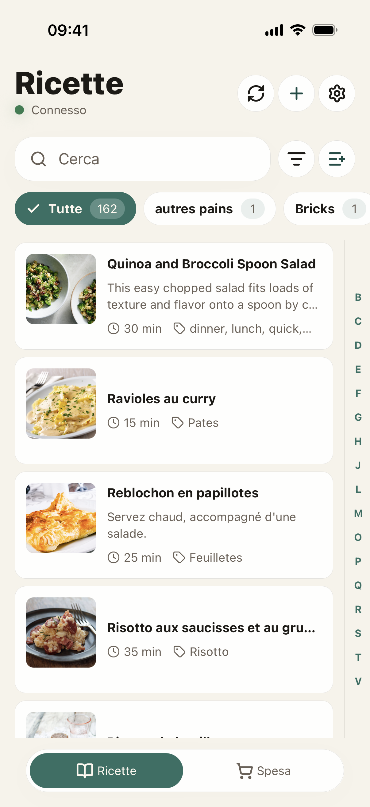
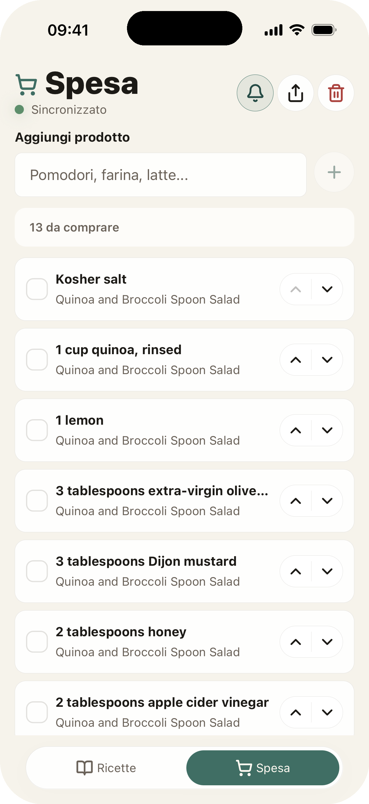

# AvoCook

[English](../../README.md) · [Français](../fr/README.md) · [Deutsch](../de/README.md) · [Español](../es/README.md) · [Italiano](README.md) · [Dansk](../da/README.md)

AvoCook è un’app gratuita e open source per iOS e Android. La sviluppo insieme ai miei studi per raccogliere ricette, pianificare pasti e rendermi un po’ più semplice cucinare ogni giorno.

[App Store](https://apps.apple.com/app/avocook/id6769012665) · [Google Play](https://play.google.com/store/apps/details?id=app.avocook.mobile) · [APK](https://github.com/Logarex/AvoCook/releases/latest)

[](https://github.com/Logarex/AvoCook/releases)

<p align="center">
  
  
  
</p>

## Funzioni

- Ricette con foto, categorie, porzioni regolabili, importazione web e Markdown facoltativo.
- Frigo, dispensa e congelatore con codici a barre, date e promemoria di scadenza.
- Piano giornaliero e settimanale, pasti semplici, avanzi, menu salvati e cronologia.
- Cucina passo dopo passo, timer salvati, comandi vocali locali e note private.
- Idee con i tuoi ingredienti, calendari stagionali regionali, conversioni e sostituzioni per dolci.
- Liste locali o condivise, notifiche, Nextcloud Pantry e Promemoria Apple su iOS.
- Ricettari PDF illustrati, condivisione di ricette e backup completi della cucina.
- Ricette della comunità da scoprire, tradurre e condividere; assistente facoltativo con la tua chiave API.

Le ricette locali funzionano offline senza account. Nextcloud Cookbook è facoltativo; piano, scorte e note private restano sul dispositivo.

## Guide

- [Guida alla cucina](GUIDE.md)
- [Dati e connessioni](PRIVACY.md)
- [Documentazione tecnica](../LOCAL_KITCHEN.md) · [Nextcloud Pantry](../NEXTCLOUD_PANTRY.md) · [Seasonal catalog](../SEASONAL_CATALOG.md)

<details>
<summary>Sviluppo e struttura del progetto</summary>

## Configurazione per lo sviluppo

Il progetto utilizza Expo SDK 57, React Native 0.86 e TypeScript. È richiesto Node.js >=22.13 e <27. Le build iOS locali utilizzano Xcode 27 e Device Hub; la versione minima di iOS supportata è 16.4.

```bash
npm ci
npm run ios      # Simulatore iOS
npm run android  # Emulatore Android
```

Dopo modifiche alle dipendenze native, esegui `npx expo prebuild --clean` e ricompila. Voce locale e promemoria delle scorte richiedono i moduli nativi locali; Expo Go non basta.

Al primo avvio viene compilata una build di sviluppo con i moduli nativi. Successivamente l'app si apre direttamente.

I progetti `ios/` e `android/` vengono generati da `app.json`, `tools/plugins/` e dai moduli locali in `src/modules/`. Dopo un aggiornamento dell’SDK o delle dipendenze native, rigenerali con `npx expo prebuild --clean` prima di compilare di nuovo. Il plugin `expo-build-properties` abilita il ciclo di vita di UIKit basato sulle scene richiesto da Xcode 27.

Comandi utili:

```bash
npm run typecheck                      # Verifiche TypeScript
npm test                               # Test unitari (Vitest)
npm run lint                           # ESLint
npm run import:check -- <url-ricetta>  # Testare l'importazione da un URL
```

---

## Struttura del progetto

```
src/
├── App.tsx                              # Punto di ingresso, navigazione
├── screens/                             # Schermate (lista, dettaglio, editor, impostazioni…)
├── components/                          # Componenti UI riutilizzabili
├── features/
│   ├── kitchen/                         # La mia cucina — pasti quotidiani, in locale
│   ├── community/                       # Firebase
│   ├── recipes/                         # Archiviazione locale (SQLite), logica ricette, backup
│   ├── nextcloud/                       # Client HTTP per Nextcloud Cookbook
│   ├── import/                          # Importazione da URL e foto
│   ├── shopping/                        # Lista della spesa e sync con Promemoria iOS
│   ├── timers/                          # Timer di cottura
│   ├── preferences/                     # Impostazioni dell'applicazione
│   └── auth/                            # Autenticazione Nextcloud
├── i18n/                                # Internazionalizzazione (i18next, 6 lingue)
├── modules/
│   └── avocook-timer-notifications/     # Modulo nativo per le notifiche dei timer
└── theme/                               # Colori, tipografia, stili condivisi
tools/                                   # Plugin di build, verifica import, asset
docs/                                    # Documentazione in altre lingue (fr, de, es, it, da)
```

---

</details>

## Nextcloud Cookbook

Per testare la sincronizzazione:

1. Installa l'[app Cookbook](https://apps.nextcloud.com/apps/cookbook) su un'istanza Nextcloud.
2. Crea una **password per l'app** nelle impostazioni di sicurezza (Impostazioni → Sicurezza → Dispositivi e sessioni).
3. In AvoCook (Impostazioni), inserisci l'URL del server, il nome utente e quella password.

Se non viene indicato un protocollo, viene usato HTTPS per impostazione predefinita. Per un server Nextcloud sulla tua rete locale fidata, inserisci un indirizzo HTTP esplicito, come `http://192.168.1.50:8080/nextcloud` o `http://nextcloud.local`. HTTP invia la password dell'app e le ricette senza cifratura; usalo solo su una rete fidata. Le credenziali restano cifrate nel portachiavi del dispositivo.

---

## Android

Gli APK sono pubblicati nelle [release GitHub](https://github.com/Logarex/AvoCook/releases). Scarica `avocook.apk` e installalo direttamente.

---

## Contribuire

Le pull request sono benvenute. Consulta [CONTRIBUTING.md](../../.github/CONTRIBUTING.md) per le linee guida e il modello di PR.

---

## Supporta il progetto ☕

Se AvoCook ti è utile, puoi contribuire a coprire le spese:

**[→ Dona tramite Revolut](https://revolut.me/logarex)** · **[→ Dona tramite PayPal](https://paypal.me/logarex31)**

---

## Sito web

Il sito è in `site/`, con i testi in sei lingue in `site/main.js`. Il comando seguente prepara gli stessi file di GitHub Pages, schermate comprese. Il sito viene pubblicato su `gh-pages` con i push a `main` o tramite il workflow manuale Deploy site; un push solo a questo ramo non pubblica il sito.

```bash
node tools/scripts/build-site.mjs
python3 -m http.server 8765 --bind 127.0.0.1 --directory dist/site
```

[http://127.0.0.1:8765/](http://127.0.0.1:8765/)

---

## Licenza

Questo progetto è rilasciato sotto licenza [GPLv3](../../LICENSE).
