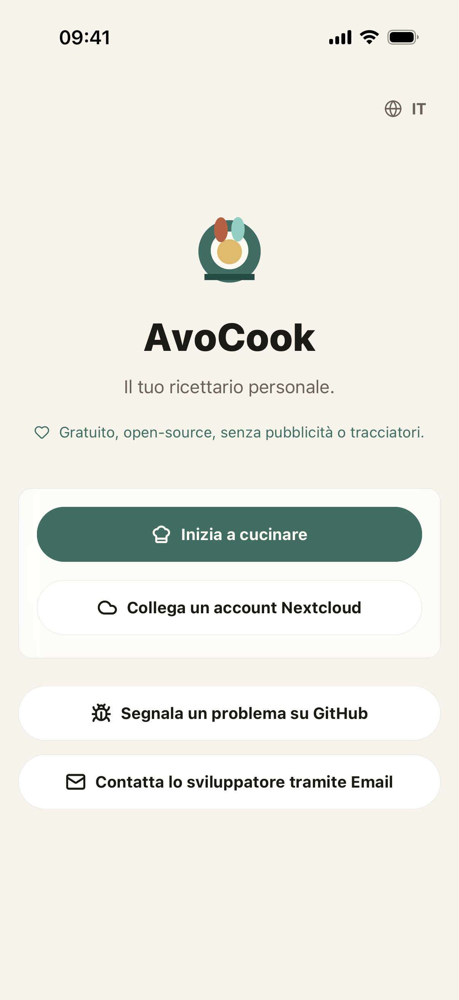

# AvoCook

[English](../../README.md) · [Français](../fr/README.md) · [Deutsch](../de/README.md) · [Español](../es/README.md) · [Italiano](README.md) · [Dansk](../da/README.md)

AvoCook è un compagno di cucina gratuito e open source per iOS e Android, con o senza ricetta. Conserva ricette, organizza i pasti quotidiani, usa gli alimenti disponibili e prepara la spesa. Gli strumenti locali funzionano offline senza creare un account; comunità, liste condivise, importazioni, IA facoltativa e connessioni Nextcloud utilizzano servizi online.

L'ho sviluppato per uso personale mentre imparavo a portare avanti un progetto React Native completo dall'inizio alla fine.

[App Store](https://apps.apple.com/app/avocook/id6769012665) · [Google Play](https://play.google.com/store/apps/details?id=app.avocook.mobile) · [APK Android](https://github.com/Logarex/AvoCook/releases/latest) · [](https://github.com/Logarex/AvoCook/releases)

<div align="center">
  
  
</div>

> Questo README descrive il ramo sorgente attuale. Le versioni negli store e nelle release GitHub potrebbero non includere ancora le ultime modifiche.

---

## Funzionalità

### Piattaforma Comunità

- Scopri, valuta e importa ricette dalla comunità AvoCook;
- Le ricette della community vengono mostrate automaticamente nella lingua dell’app, sia nell’elenco sia nei dettagli;
- Consulta la ricetta originale in qualsiasi momento o importa la versione tradotta nel tuo ricettario;
- Condividi i tuoi piatti migliori impostando un profilo comunitario;
- Include segnalazioni della comunità e controlli antispam; i contenuti pubblicati sono forniti dagli utenti.
- Scegli una lingua diversa per tradurre la comunità, tra cui cinese, portoghese, olandese, giapponese, coreano, arabo e russo. Ricette caricate e traduzioni riuscite vengono salvate per la lettura offline.

### Ricette

- Creare e modificare ricette localmente, senza account;
- Organizzare le ricette per categoria;
- Adattare le quantità al numero di porzioni;
- Aggiungere una o più foto a ogni ricetta;
- Esportare una ricetta in PDF o stamparla direttamente;
- Condividere una ricetta con un'altra app.

### La mia cucina — pasti quotidiani, in locale

Inizia in La mia cucina: Oggi, Settimana, I miei alimenti e Idee per i pasti. Gli strumenti occasionali sono sotto la chiave inglese.

- **Organizza la settimana** — Aggiungi pranzi e cene, trascina ricette tra i giorni e adatta le porzioni. Controlla gli ingredienti raggruppati prima di aggiungerli alla spesa.
- **Pasti senza ricetta** — Annota un pasto veloce, riutilizza un pasto abituale o pianifica avanzi e uscite. Solo i pasti con ingredienti contribuiscono alla spesa.
- **Usa quello che hai** — Salva alimenti di frigo, dispensa e congelatore con le date. Trova ricette con meno ingredienti mancanti e controlla gli acquisti. Promemoria locali delle date facoltativi.
- **Frutta e verdura di stagione** — Scegli zona e mese, cerca o filtra e seleziona prodotti per la spesa o idee di ricette. Calendari offline con fonti e copertura regionale esplicita.
- **Cucina passo dopo passo** — Un passaggio in caratteri grandi, avanzamento, ingredienti e timer. Comandi vocali locali facoltativi se supportati; avvisi secondo permessi e impostazioni del dispositivo.
- **Una ricetta dal tuo frigo (IA)** — Inserisci ingredienti o analizza una foto, correggi gli alimenti riconosciuti e genera una bozza modificabile. Facoltativo: la tua chiave API e un modello adatto; il fornitore può addebitare le richieste.
- **Un diario di cucina privato** — Valutazioni, note, modifiche, date di preparazione, difficoltà e costi inseriti a mano. Etichette alimentari e filtri personali aiutano a organizzare; non certificano l’assenza di allergeni.
- **Batch cooking e menu** — Scegli 3–5 ricette, raggruppa la spesa e consulta le attività per durata. Salva menu per le feste e pianificali; nessuna cottura parallela automatica.
- **Il tuo libro di ricette** — Seleziona fino a 50 ricette per un PDF di testo locale con indice, ingredienti e passaggi. Note private e foto escluse.
- **Strumenti pratici** — Scegli una ricetta a sorpresa, converti unità compatibili e temperature o consulta sostituzioni per dolci secondo la preparazione, con proporzioni e precauzioni. Nessuna conversione inventata tra grammi e millilitri.
- **Backup sotto il tuo controllo** — Esporta ricette in JSON o usa il backup completo di La mia cucina per ricette, foto locali disponibili e pianificazione privata. Controlla prima di ripristinare.

Calendari disponibili: Francia metropolitana, Vallonia (Belgio), Svizzera, Germania, Spagna, Italia, Regno Unito, Danimarca, Ontario (Canada), Stato di New York (USA) e Sydney (Australia). 11 paesi con limiti regionali, non copertura mondiale. Le fonti distinguono raccolta, conservazione o disponibilità commerciale; sono indicazioni, non previsioni in tempo reale.

La ricerca per ingredienti non verifica quantità disponibili, freschezza o allergeni. Le etichette alimentari sono inserite dall’utente. Le sostituzioni riguardano solo preparazioni supportate. Voce e notifiche dipendono dal dispositivo e dai permessi.

[Funzionamento e limiti](../LOCAL_KITCHEN.md) · [Fonti del catalogo stagionale](../SEASONAL_CATALOG.md)

Filtra le idee per durata nota (≤30 minuti), voto personale (≥4/5), difficoltà facile ed etichette alimentari personali. La cronologia include pasti confermati come consumati e preparazioni registrate nel diario o nella modalità cucina.

### Markdown facoltativo

Tutti i campi di testo delle ricette accettano Markdown, in ogni lingua: nome, descrizione, categoria, parole chiave, nome della fonte, ingredienti, istruzioni, utensili e valori nutrizionali. Il testo semplice resta la scelta predefinita; non serve conoscere Markdown.

Usa `**grassetto**`, `*corsivo*`, titoli, elenchi, citazioni, codice, tabelle o `[un link](https://example.com)`. La formattazione appare durante la lettura, nei PDF e nella stampa. Le immagini Markdown appaiono come link. I numeri (porzioni e durate) e i campi URL mantengono il formato abituale.

Ogni ingrediente e istruzione conserva il proprio Markdown, inclusi paragrafi ed elenchi annidati. Incollare righe di testo semplice crea ancora elementi separati; incollare un blocco Markdown lo mantiene unito.

### Importazione

- Importa da pagine compatibili con dati `schema.org/Recipe` accessibili; alcuni siti bloccano l’estrazione o forniscono dati incompleti.
- Ricevere un URL condiviso da un browser o un'altra app per importare una ricetta con un tocco;
- IA facoltativa: scansiona ricette, genera da testo o foto di un piatto o crea una bozza con il frigo. Scegli OpenAI, Gemini, Groq, Grok, Mistral, Claude o un endpoint personalizzato nelle impostazioni Assistente. Servono la tua chiave API e un modello compatibile; le foto richiedono visione e il fornitore può addebitare le richieste.

### Lista della spesa

- Scegli spesa locale, condivisione AvoCook o Nextcloud Pantry, con trasferimento degli articoli al cambio. La sincronizzazione facoltativa con Promemoria iOS funziona nelle tre modalità. [Nextcloud Pantry](../NEXTCLOUD_PANTRY.md).
- Condividi liste della spesa con un codice di 6 caratteri, un conteggio dei partecipanti e avvisi locali mentre AvoCook è in esecuzione;
- Copiare gli ingredienti negli appunti con un tocco;
- Esportare una lista della spesa in Promemoria iOS per sfruttare la condivisione Apple e l'integrazione con Siri.

### Timer

- Avviare uno o più timer di cottura direttamente da una ricetta;
- Gli avvisi locali dei timer possono funzionare in background secondo permessi e impostazioni di sistema; verifica la ricezione sul tuo dispositivo.

### Dati e sincronizzazione

- Eseguire il backup di tutte le ricette in un file JSON e ripristinarle;
- **Facoltativo**: collegare un server Nextcloud Cookbook per sincronizzare le ricette tra i dispositivi. I dati passano direttamente tra l'app e il tuo server, senza intermediari.

> Le ricette locali restano sul dispositivo, salvo sincronizzazione, condivisione o esportazione. La community usa Firebase con una sessione anonima all’avvio. Vedi [Privacy e dati](PRIVACY.md).

---

## Lingue disponibili

Francese · Inglese · Tedesco · Spagnolo · Italiano · Danese

---

## Configurazione per lo sviluppo

Il progetto utilizza Expo SDK 57, React Native 0.86 e TypeScript. È richiesto Node.js >=22.13 e <27. Le build iOS locali utilizzano Xcode 27 e Device Hub; la versione minima di iOS supportata è 16.4.

```bash
npm ci
npm run ios      # Simulatore iOS
npm run android  # Emulatore Android
```

Dopo modifiche alle dipendenze native, esegui `npx expo prebuild --clean` e ricompila. Voce locale e promemoria delle scorte richiedono i moduli nativi locali; Expo Go non basta.

Al primo avvio viene compilata una build di sviluppo con i moduli nativi. Successivamente l'app si apre direttamente.

I progetti `ios/` e `android/` vengono generati da `app.json`, `tools/plugins/` e dai moduli locali in `src/modules/`. Dopo un aggiornamento dell’SDK o delle dipendenze native, rigenerali con `npx expo prebuild --clean` prima di compilare di nuovo. Il plugin `expo-build-properties` abilita il ciclo di vita di UIKit basato sulle scene richiesto da Xcode 27.

Comandi utili:

```bash
npm run typecheck                      # Verifiche TypeScript
npm test                               # Test unitari (Vitest)
npm run lint                           # ESLint
npm run import:check -- <url-ricetta>  # Testare l'importazione da un URL
```

---

## Struttura del progetto

```
src/
├── App.tsx                              # Punto di ingresso, navigazione
├── screens/                             # Schermate (lista, dettaglio, editor, impostazioni…)
├── components/                          # Componenti UI riutilizzabili
├── features/
│   ├── kitchen/                         # La mia cucina — pasti quotidiani, in locale
│   ├── community/                       # Firebase
│   ├── recipes/                         # Archiviazione locale (SQLite), logica ricette, backup
│   ├── nextcloud/                       # Client HTTP per Nextcloud Cookbook
│   ├── import/                          # Importazione da URL e foto
│   ├── shopping/                        # Lista della spesa e sync con Promemoria iOS
│   ├── timers/                          # Timer di cottura
│   ├── preferences/                     # Impostazioni dell'applicazione
│   └── auth/                            # Autenticazione Nextcloud
├── i18n/                                # Internazionalizzazione (i18next, 6 lingue)
├── modules/
│   └── avocook-timer-notifications/     # Modulo nativo per le notifiche dei timer
└── theme/                               # Colori, tipografia, stili condivisi
tools/                                   # Plugin di build, verifica import, asset
docs/                                    # Documentazione in altre lingue (fr, de, es, it, da)
```

---

## Nextcloud Cookbook

Per testare la sincronizzazione:

1. Installa l'[app Cookbook](https://apps.nextcloud.com/apps/cookbook) su un'istanza Nextcloud.
2. Crea una **password per l'app** nelle impostazioni di sicurezza (Impostazioni → Sicurezza → Dispositivi e sessioni).
3. In AvoCook (Impostazioni), inserisci l'URL del server, il nome utente e quella password.

Se non viene indicato un protocollo, viene usato HTTPS per impostazione predefinita. Per un server Nextcloud sulla tua rete locale fidata, inserisci un indirizzo HTTP esplicito, come `http://192.168.1.50:8080/nextcloud` o `http://nextcloud.local`. HTTP invia la password dell'app e le ricette senza cifratura; usalo solo su una rete fidata. Le credenziali restano cifrate nel portachiavi del dispositivo.

---

## Android

Gli APK sono pubblicati nelle [release GitHub](https://github.com/Logarex/AvoCook/releases). Scarica `avocook.apk` e installalo direttamente.

---

## Contribuire

Le pull request sono benvenute. Consulta [CONTRIBUTING.md](../../.github/CONTRIBUTING.md) per le linee guida e il modello di PR.

---

## Supporta il progetto ☕

Se AvoCook ti è utile, puoi contribuire a coprire le spese:

**[→ Dona tramite Revolut](https://revolut.me/logarex)** · **[→ Dona tramite PayPal](https://paypal.me/logarex31)**

---

## Sito web

Il sito è in `site/`, con i testi in sei lingue in `site/main.js`. Il comando seguente prepara gli stessi file di GitHub Pages, schermate comprese. Il sito viene pubblicato su `gh-pages` con i push a `main` o tramite il workflow manuale Deploy site; un push solo a questo ramo non pubblica il sito.

```bash
node tools/scripts/build-site.mjs
python3 -m http.server 8765 --bind 127.0.0.1 --directory dist/site
```

[http://127.0.0.1:8765/](http://127.0.0.1:8765/)

---

## Licenza

Questo progetto è rilasciato sotto licenza [GPLv3](../../LICENSE).
